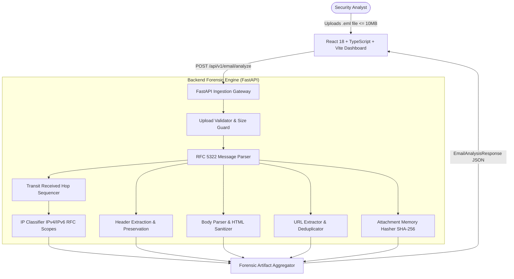

# PhishIntel Architecture — Phase 1: Foundation and Email Forensic Parser

## 1. System Overview

PhishIntel Phase 1 establishes the local-first forensic ingestion and parsing engine for RFC 5322 `.eml` email files. The architecture is deliberately divided into an isolated FastAPI backend engine and a responsive, secure React + TypeScript dashboard.

---

## 2. Core Architectural Components

### 2.1. Ingestion Gateway & Size Guard (`backend/app/api/v1/endpoints/email.py`)
- **Extension Whitelist**: Rejects any file upload that does not end in `.eml` (case-insensitive) with HTTP 400.
- **Streaming Size Enforcement**: Streams chunks up to `10 MB` (`10,485,760 bytes`). If bytes read exceed this threshold, reading halts immediately and returns HTTP 413, preventing memory exhaustion attacks.
- **Empty File Guard**: Immediately rejects 0-byte uploads with HTTP 400.
- **Stateless Lifecycle**: In-memory parsing only. Uploaded email streams are discarded after response generation; no persistent database or file storage is created.

### 2.2. RFC 5322 Forensic Parser (`backend/app/services/email_parser.py`)
- **Parser Engine**: Uses Python's standard `email` library with `email.policy.default` (RFC 5322 compliant), falling back to `email.policy.compat32` if irregular boundaries or obsolete syntax are encountered.
- **Header Preservation**:
  - Extracts standard single-value headers (`From`, `Subject`, `Date`, `Message-ID`, `Reply-To`, `Return-Path`, `MIME-Version`, `Content-Type`).
  - Correctly parses recipient address lists (`To`, `Cc`, `Bcc`).
  - Preserves multi-value security headers in arrival order (`Authentication-Results`, `Received-SPF`).
  - Captures the complete ordered sequence of all `Received` headers representing transit hops, preserved exactly as extracted (index 0 is typically the newest hop; the final index is typically the oldest hop closest to origin).

### 2.3. Transit Hop & Candidate IP Classifier (`backend/app/services/ip_extractor.py`)
- **Candidate IP Extraction**: Scans all `Received` transit headers for valid IPv4 octets and IPv6 addresses.
- **Strict RFC Scope Distinction**: Avoids blanket labelling based on `is_private`. Explicitly categorizes each candidate into:
  - `Loopback` (`127.0.0.0/8`, `::1`)
  - `Link-Local` (`169.254.0.0/16`, `fe80::/10`)
  - `Multicast` (`224.0.0.0/4`, `ff00::/8`)
  - `Documentation` (RFC 5737 TEST-NET-1 `192.0.2.0/24`, TEST-NET-2 `198.51.100.0/24`, TEST-NET-3 `203.0.113.0/24`, and RFC 3849 IPv6 `2001:db8::/32`) — strictly prevented from being misclassified as private or public
  - `Private` (Strictly RFC 1918 `10.0.0.0/8`, `172.16.0.0/12`, `192.168.0.0/16` and RFC 4193 `fc00::/7` ULA)
  - `Special-Purpose` (RFC 6598 CGNAT `100.64.0.0/10`, RFC 2544 Benchmarking `198.18.0.0/15`, IETF Protocol assignments)
  - `Reserved` (RFC 1112 `240.0.0.0/4`, `255.255.255.255/32`, `0.0.0.0/8`, `::`)
  - `Public` (Globally routable unicast IP addresses)
- **Forensic Evidence Tracking**: Preserves the hop index (0-based) and a raw snippet of the header from which each IP was derived.
- **No Premature Assumptions**: The parser never assumes the first IP found is the originating sender, leaving hop analysis uncorrupted for future phase attribution.

### 2.4. Passive URL Extractor
- Extracts URLs from `text/plain` bodies via regular expressions.
- Extracts `href` attributes from HTML `<a>` tags via BeautifulSoup.
- Deduplicates URLs while tagging each entry's origin (`plain_text`, `html_href`, or `both`).
- Decomposes URLs into scheme (`http` / `https`) and domain/host without making any network requests.

### 2.5. Memory-Isolated Attachment Hasher
- Iterates through MIME parts identifying attachments via `Content-Disposition` or filename attributes.
- Computes SHA-256 cryptographic hashes from memory payloads without writing files to disk.
- Sanitizes filenames against path traversal attacks (`os.path.basename` and stripping control characters).

### 2.6. Cybersecurity Dashboard (`frontend/`)
- Built with React 18, TypeScript, Vite, and Tailwind CSS.
- Adheres to a dark cybersecurity investigation theme (`#0B0F19` charcoal/navy background with cyan, blue, purple, and emerald status badges).
- Tabbed investigation view:
  - Overview Banner (file size, hops count, URLs count, attachments count, candidate IPs count).
  - RFC 5322 Headers & Chronological Received Hops.
  - Candidate IPs & Scope Badges.
  - Extracted URLs & Domains.
  - Attachment Metadata & SHA-256 Hashes.
  - Sanitized Body Text Viewer.

---

## 3. Security Boundary & Threat Model

| Threat / Risk | Mitigation Mechanism in Phase 1 |
| :--- | :--- |
| **Malicious HTML / XSS** | Untrusted HTML is parsed with BeautifulSoup to extract clean text. Active tags (`<script>`, `<style>`, `<iframe>`) are discarded. HTML is never rendered directly into the DOM (`dangerouslySetInnerHTML` is prohibited). |
| **Accidental Link Activation** | Extracted URLs are rendered inert (non-clickable text blocks). Users cannot trigger external lookups by clicking. |
| **Denial of Service / Zip Bombs** | Strict 10 MB streaming ceiling enforced at the gateway. Files over 10 MB immediately return HTTP 413. |
| **Executable Attachment Execution** | Attachments are held solely in volatile memory buffers. Files are never saved to disk, given executable permissions, or launched. |
| **Data Leakage / Telemetry** | Zero external API calls, DNS lookups, or third-party telemetry. All parsing executes purely on the local machine. |
| **Path Traversal Attacks** | Attachment filenames undergo path sanitization removing directory traversal delimiters (`../` and `..\`). |

---

## 4. Phase 1 Scope Boundary

To ensure a robust, uncompromised foundation, the following items are strictly excluded from Phase 1 and reserved for subsequent phases:
- Machine Learning classifiers (Random Forest, XGBoost, BERT, RoBERTa).
- Phishing probability scores or threat ratings.
- Live external DNS / WHOIS queries.
- Live SPF/DKIM cryptographic validation against live DNS TXT records.
- Third-party IP reputation APIs (VirusTotal, AbuseIPDB, Shodan).
- Database persistence or multi-session email history.
