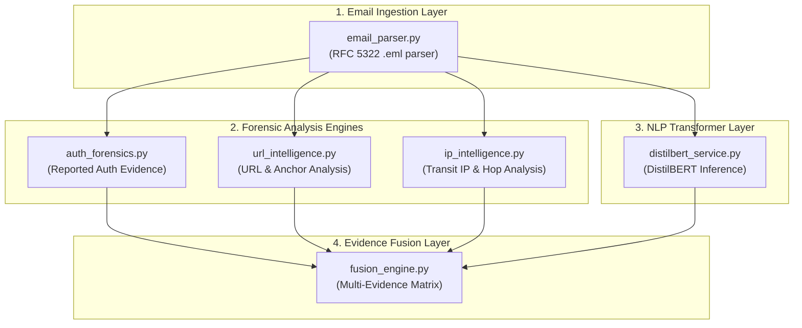
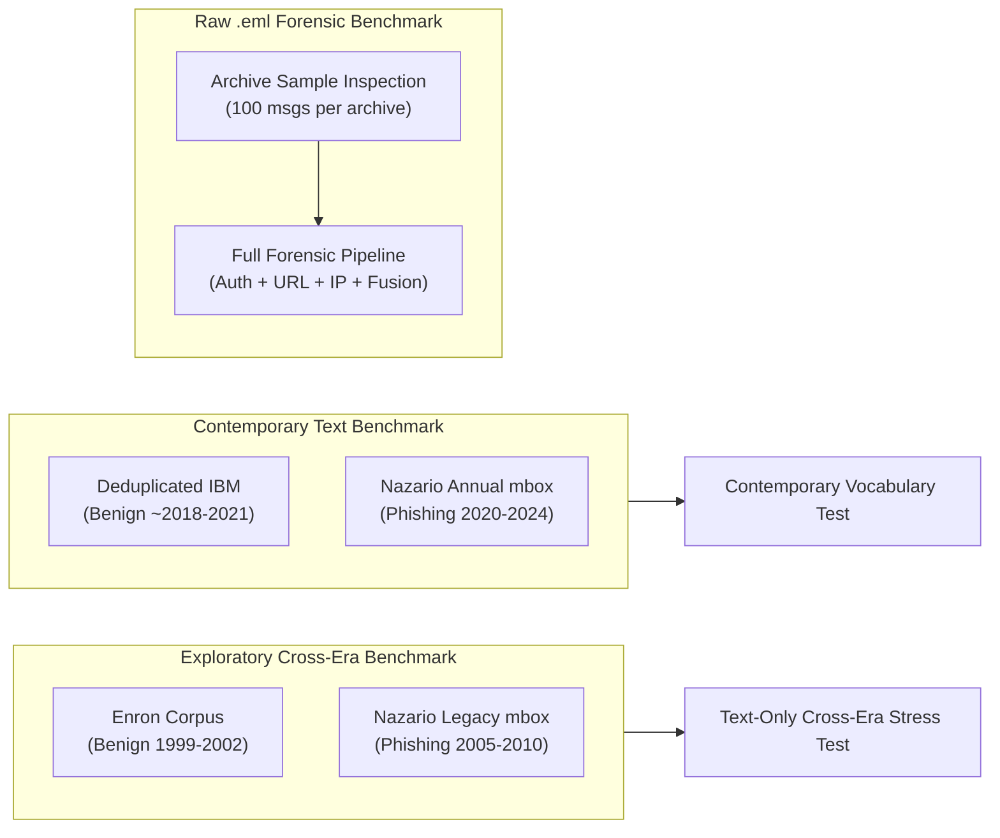
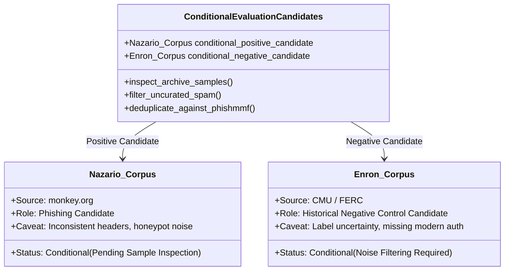

# External Dataset Feasibility Audit: Independent Evaluation of PhishIntel Model & Forensic Pipeline

**Project**: PhishIntel: Transformer-Based Phishing Detection with Cryptographic Authentication and IP Intelligence  
**Document**: Phase 10 — External Dataset Feasibility Investigation & Evaluation Roadmap  
**Date**: November 2026 (Revised Audit)  
**Auditor / Agent**: Antigravity Automated Verification Agent  
**Status**: **`AUDIT_REVISED_AND_CORRECTED`**  
**Investigation Mode**: Strictly Read-Only (Zero Code/Data Modifications, Zero Dataset Downloads)

---

## 1. Executive Summary

### 1.1 Context and Motivation
PhishIntel integrates a fine-tuned DistilBERT transformer model with an end-to-end forensic analysis engine (cryptographic authentication verification, URL intelligence, and IP routing analysis) coordinated by an evidence fusion engine.

As documented in [Phase 3D Source-Leakage Audit](file:///c:/Users/Lenovo/Desktop/PhishIntel/docs/phase3/phase3d_source_leakage_audit.md) and [Model Reliability Diagnostic Audit](file:///c:/Users/Lenovo/Desktop/PhishIntel/docs/phase10/model_reliability_diagnostic_audit.md), the internal canonical training dataset (**PhishMMF**) exhibits two structural vulnerabilities:
1. **Absolute Source-Label Collinearity**: 100% of the 5,959 benign samples originate from historical 2002–2008 corpora (`CEAS_08_0` and `SpamAssasin_0`), while 100% of the 1,280 phishing samples originate from a contemporary honeypot (`phishing_pot`, 2023–2024).
2. **Synthetic Artifact Exploitation**: 35.39% of all phishing samples contain the redacted synthetic token `<USER>` ($P(\text{Phishing} \mid \text{"<USER>"}) = 1.0$), whereas benign samples contain zero occurrences.

Consequently, while the model achieved in-distribution test metrics of $98.76\%$ accuracy and $96.50\%$ F1, real-world testing (e.g., the Phase 10 LinkedIn account-completion test email) triggered a false positive with an uncalibrated phishing score of $0.9918$. 

To scientifically evaluate the feasibility of external benchmarking, this investigation audits five candidate public email datasets:
1. **MeAJOR** (Zenodo DOI: `10.5281/zenodo.18471483`)
2. **Phishing-Email-Detection-Dataset** (Zenodo DOI: `10.5281/zenodo.17314806` / `Manar-ibr`)
3. **Enron Email Corpus** (Carnegie Mellon University / Prof. William W. Cohen)
4. **IBM Phishing Email Dataset** (Hugging Face / `jmmrcp/Phishing-IBM-Dataset`)
5. **Nazario Phishing Corpus** (Jose Nazario / `monkey.org/~jose/phishing/`)

### 1.2 Summary Evaluation Verdicts

All candidate datasets carry important caveats. No candidate is granted an unqualified blanket pass:

| Candidate Dataset | Host / Primary Source | Data Format | Raw `.eml` Available? | Forensic Headers Present? | Contamination with PhishMMF | NLP Feasibility | Forensic Feasibility | Corrected Scientific Verdict |
| :--- | :--- | :--- | :---: | :---: | :---: | :---: | :---: | :---: |
| **1. MeAJOR** | Zenodo `10.5281/zenodo.18471483` | Parquet / CSV | **No** (Stripped) | **None** | Moderate to High (TREC) | Conditional (Entity masked) | **No-Go** | **`CONDITIONAL GO`** (NLP-only) |
| **2. Alhuzali et al.** | Zenodo `10.5281/zenodo.17314806` | CSV | **No** (Stripped) | **None** | **Critical (Direct CEAS & SpamAssassin overlap)** | **No-Go** (Leakage) | **No-Go** | **`NO-GO`** (Current Model Evaluation) |
| **3. Enron Corpus** | CMU / SRI (Cohen et al.) | RFC 822 Maildir | **Yes** (Text) | Internal only (Pre-DMARC) | Low / None | **Conditional** (Uncurated noise) | Conditional (Missing modern auth) | **`CONDITIONAL GO`** (Historical Negative Control) |
| **4. IBM Phishing** | Hugging Face `jmmrcp/Phishing-IBM-Dataset` | Parquet / Arrow | **No** (Tabular) | **None** | `UNKNOWN` (Requires deduplication) | **Conditional** (Text-only) | **No-Go** | **`CONDITIONAL GO`** (NLP Candidate) |
| **5. Nazario Corpus** | `monkey.org/~jose/phishing/` | RFC 5322 `mbox` | **Yes** (Mbox) | Variable (Inconsistent) | Low (Disjoint from `phishing_pot`) | **Conditional** (Honeypot text) | Conditional (Pending archive inspection) | **`CONDITIONAL GO`** (Phishing Candidate) |

---

## 2. Comprehensive Candidate Dataset Deep-Dive

### 2.1 Candidate 1: MeAJOR (Merged email Assets from Joint Open-source Repositories)

* **Identifier / DOI**: Zenodo DOI: [10.5281/zenodo.18471483](https://doi.org/10.5281/zenodo.18471483) (Version 2.0).
* **Curators & Provenance**: Created by Francisco Cardoso, João Vitorino, Paulo Mendes, Eva Maia, and Isabel Praça at GECAD (Research Group on Intelligent Engineering and Computing for Advanced Innovation and Development), School of Engineering, Polytechnic of Porto (ISEP), Portugal.
* **Scale & Class Distribution**: Exactly 108,685 preprocessed samples stored in Apache Parquet and CSV. Binary classification target: `0` (benign / legitimate) and `1` (phishing / malicious).
* **Temporal Coverage**: Spans historical collections from approximately 1998 through ~2015+ (synthesized from TREC-05, TREC-06, TREC-07 spam tracks, the Nazario phishing corpus, and Nigerian Fraud datasets).
* **Raw `.eml` / MIME Availability**: **None**. The dataset is distributed strictly in tabular format. Raw RFC 822/5322 MIME structures, base64 attachments, and transmission envelopes are stripped.
* **Integrity of URLs, Domains, and Message Text**: **Synthetically Tokenized**. In MeAJOR, privacy and normalization policies replaced all hyperlink URLs with the token `[URL]`, email addresses with `[EMAIL_ADDRESS]`, organization names with `[ORGANIZATION]`, and financial numbers with `[FINANCIAL_INFO]`.
* **Cryptographic & Transit Headers**: **Completely Absent**. Headers (`Authentication-Results`, `DKIM-Signature`, `Received-SPF`, `Received` chains) are deleted.
* **Contamination Risk with PhishMMF**: Moderate to High. TREC spam tracks utilized overlapping benchmark data feeds with CEAS and SpamAssassin.
* **Licensing & Rights Analysis**:
  - *Compilation License*: Creative Commons Attribution 4.0 International (`CC BY 4.0`) covers the dataset curation, engineered features, and distribution scripts.
  - *Underlying Content Rights*: `UNKNOWN`. The compilation license does not transfer or alter copyright in the underlying third-party email communications.
* **PhishIntel Parsing Compatibility**:
  - `email_parser.py`: Incompatible (expects raw bytes or RFC 5322 strings).
  - `auth_forensics.py`: Incompatible (0% header data).
  - `url_intelligence.py`: Incompatible (no hyperlinks exist; all URLs are masked as `[URL]`).
  - `ip_intelligence.py`: Incompatible (no `Received` headers).
  - DistilBERT (`distilbert_service.py`): Incompatible with standard tokenization without pre-processing. DistilBERT WordPiece tokenizer breaks `[URL]` into three tokens `['[', 'url', ']']`, causing an out-of-distribution artifact compared to PhishMMF training text.
* **Known Limitations & Biases**: Heavy entity replacement distorts linguistic syntax, destroys URL lexical structure (disabling TLD entropy, subdomain depth, and punycode detection), and strips structural signals.
* **Scientific Verdict**: **`CONDITIONAL GO` (NLP-Only)**.
  - Inoperable for full forensic pipeline evaluation.
  - Feasible for offline text-classifier ablation only if an adapter translates `[URL]` and entity tokens into dummy strings.

---

### 2.2 Candidate 2: Phishing-Email-Detection-Dataset (Alhuzali et al. / Zenodo `10.5281/zenodo.17314806`)

* **Identifier / DOI**: Zenodo DOI: [10.5281/zenodo.17314806](https://doi.org/10.5281/zenodo.17314806). Code repository: `Manar-ibr/Phishing-Email-Detection-Dataset`.
* **Curators & Provenance**: Compiled by Abeer Alhuzali, Ahad Alloqmani, Manar Aljabri, and Fatemah Alharbi (2025). Published in *Applied Sciences* (MDPI, 2025): *"In-Depth Analysis of Phishing Email Detection: Evaluating the Performance of Machine Learning and Deep Learning Models Across Multiple Datasets"*.
* **Scale & Class Distribution**: Consolidated multi-source CSV files containing columns `body` (or `text`) and `label` (`0` = Safe/Benign, `1` = Phishing/Spam). Class sizes are downsampled and balanced across subsets (tens of thousands of rows across individual files).
* **Temporal Coverage**: Historical to mid-era (~2000–2015), aggregating legacy public corpora.
* **Raw `.eml` / MIME Availability**: **None**. Distributed solely as CSV tables.
* **Integrity of URLs, Domains, and Message Text**: Partial. Raw HTML structure is stripped into plain text. Hyperlinks inside the message text are either stripped or left as unanchored plaintext strings.
* **Cryptographic & Transit Headers**: **Completely Absent**. No RFC 5322 headers exist in the dataset.
* **Contamination Risk with PhishMMF**: **CRITICAL CONTAMINATION (FATAL FLAW)**.
  - PhishMMF's benign training and test splits (`CEAS_08_0` with 2,981 records and `SpamAssasin_0` with 2,978 records) form the exact foundational source material for the Alhuzali et al. consolidation.
  - Evaluating DistilBERT on this dataset would result in circular validation: testing the model on the very corpus on which its benign weights were trained.
* **Licensing & Rights Analysis**:
  - *Compilation License*: Open Access publication on Zenodo (`CC BY 4.0`).
  - *Underlying Content Rights*: `UNKNOWN`. Aggregates historical open corpora without distinct sub-licensing.
* **PhishIntel Parsing Compatibility**:
  - `email_parser.py`: Incompatible.
  - `auth_forensics.py`: Incompatible.
  - `url_intelligence.py`: Incompatible.
  - `ip_intelligence.py`: Incompatible.
  - DistilBERT (`distilbert_service.py`): Ingestible via direct text injection, but invalid due to training leakage.
* **Scientific Verdict**: **`NO-GO`**. Unsuitable for current model evaluation due to direct circular training data leakage, and unusable for forensic pipeline evaluation due to total absence of headers and envelope metadata.

---

### 2.3 Candidate 3: Enron Email Corpus (CMU / William W. Cohen)

* **Identifier / Access**: Carnegie Mellon University (CMU) Email Research Repository ([`cs.cmu.edu/~enron/`](https://www.cs.cmu.edu/~enron/)).
* **Curators & Provenance**: Originates from corporate email mailboxes of the Enron Corporation, subpoenaed and disclosed by the Federal Energy Regulatory Commission (FERC) during federal investigations. Curated, cleaned, and mirrored for research by Prof. William W. Cohen and the SRI International CALO Project.
* **Scale & Format**: Approximately 517,431 messages from ~150 employee and executive mailboxes, stored in Maildir format (individual text files with RFC 822 / RFC 2822 header blocks).
* **Classification & Labeling Uncertainty**:
  - **Not a Verified 100% Benign Ground Truth**: The corpus represents raw employee mailbox captures. It contains uncurated inbound external mail, newsletters, personal correspondence, chain letters, jokes, and unsolicited commercial email (spam).
  - It was never comprehensively annotated or audited by security analysts for absence of malware or social engineering.
  - It serves as a **historical corporate-email negative-control candidate**, subject to inherent label noise.
* **CMU-Documented Integrity Concerns**:
  - *Data Cleaning Iterations*: Multiple cleanup rounds were required by SRI and CMU to fix corrupted headers and folder nesting.
  - *Header Normalization*: Missing, unparseable, or blank recipient headers were automatically normalized (e.g., defaulted to `no_address@enron.com`).
  - *Redactions and Message Deletions*: A significant number of messages were deleted or redacted post-release in response to privacy requests by affected employees.
  - *Duplicate Content*: Substantial duplication exists due to multi-recipient internal distribution across `inbox`, `sent_items`, and `all_documents` folders.
  - *Absence of Attachments*: **All file attachments were completely stripped** from the standard CMU distribution to conserve bandwidth and protect privacy. PhishIntel's attachment inspection logic (`application/x-dosexec`) cannot be exercised on this dataset.
* **Temporal Coverage**: 1999–2002.
* **Cryptographic & Transit Headers**: **Absent (Pre-DMARC Era)**.
  - In 1999–2002, SPF (RFC 4408 / RFC 7208), DKIM (RFC 4871 / RFC 6376), and DMARC (RFC 7489) did not exist.
  - `Authentication-Results` (RFC 5451 / RFC 8601) headers are completely absent.
  - Routing headers reflect internal corporate Microsoft Exchange / Lotus Notes relay agents, not modern internet gateway perimeters.
* **Licensing & Legal Status**:
  - *Public Record Status*: Released as a public regulatory record by FERC.
  - *Copyright Status of Underlying Content*: **`UNKNOWN`**. Public availability as a regulatory disclosure does **not** establish public-domain dedication under US copyright law. The copyright in individual personal and business messages belongs to their respective authors or corporate successors. Distributed openly for academic/educational research under ethical privacy guidelines.
* **PhishIntel Parsing Compatibility**:
  - `email_parser.py`: Compatible with RFC 822 text files.
  - `auth_forensics.py`: Reports `AUTH_RESULTS_MISSING` / `SPF=NONE`, `DKIM=NONE`, `DMARC=NONE`, accurately reflecting historical reality.
  - `url_intelligence.py`: Compatible with plain text body URLs; cannot test modern HTML link obfuscation.
  - `ip_intelligence.py`: Tests RFC 1918 private IP classification on internal routing hops.
  - DistilBERT (`distilbert_service.py`): Compatible for testing text false-positive rates on complex business language.
* **Scientific Verdict**: **`CONDITIONAL GO` (Historical Negative-Control Candidate)**.
  - Approved as a historical negative-control candidate to evaluate false-positive resistance against corporate business dialogue.
  - Requires pre-filtering to remove uncurated spam, automated bounces, and corrupted message headers.

---

### 2.4 Candidate 4: IBM Phishing Email Dataset (Hugging Face Hub)

* **Identifier / Access**: Hugging Face Hub: [`jmmrcp/Phishing-IBM-Dataset`](https://huggingface.co/datasets/jmmrcp/Phishing-IBM-Dataset) (also referenced in `puyang2025/seven-phishing-email-datasets` as `email_ibm`).
* **Curators & Provenance**: Hosted on Hugging Face Hub by community contributor `jmmrcp` and mirrored in multi-corpus benchmark studies. Originates from enterprise security evaluation testbeds associated with IBM security research.
* **Scale & Class Distribution**: Approximately 16,672 raw email samples in its initial tabular form. Mixed binary distribution containing legitimate business emails and targeted phishing lures.
* **Temporal Coverage**: Mid-to-modern era (~2015–2021).
* **Raw `.eml` / MIME Availability**: **None**. Distributed as Hugging Face dataset tables (Apache Arrow / Parquet). Schema fields include `text`, `subject`, `label`, `sender`, `receiver`, and `date`.
* **Integrity of URLs, Domains, and Message Text**: Message bodies and subjects are intact. Hyperlink URLs inside text bodies are preserved as literal strings, but HTML anchor contexts (`href` vs. display text) are flattened. Full RFC 5322 header blocks are missing.
* **Reassessment of Overlap Risk**:
  - *Reported External Benchmark Overlap (30.99%)*: In published comparative research (e.g., MDPI studies benchmarking multi-corpus phishing models), deduplication of the raw 16,672 `jmmrcp/Phishing-IBM-Dataset` against the external `zefang-liu/phishing-email-dataset` using a 200-character prefix match resulted in the removal of **30.99%** of raw records (leaving 11,505 cleaned entries).
  - *Distinction*: **This 30.99% overlap is an external benchmark finding between IBM and `zefang-liu`**; it is **not** proof of overlap with PhishMMF.
  - *PhishMMF Overlap Requirement*: The exact overlap between IBM Phishing and PhishMMF is currently **`UNKNOWN`**. Before any evaluation can proceed, direct empirical deduplication (exact SHA-256 and 200-character prefix matching) against PhishMMF's protected files (`train.csv`, `validation.csv`, `test.csv`) must be performed.
* **Licensing & Rights Analysis**:
  - *Upstream Corporate License*: **`UNKNOWN`**. The repository card on Hugging Face does not provide formal documentation of IBM's original distribution terms, corporate copyrights, or commercial reuse permissions.
* **PhishIntel Parsing Compatibility**:
  - Incompatible with raw `.eml` ingestion, header authentication, and IP transit analysis.
  - Compatible with DistilBERT text inference via the `text` field.
* **Scientific Verdict**: **`CONDITIONAL GO` (NLP Candidate)**.
  - Feasible only as a secondary text-classification benchmark.
  - Conditioned on performing direct deduplication against PhishMMF and verifying upstream licensing terms.

---

### 2.5 Candidate 5: Nazario Phishing Corpus (Jose Nazario / `monkey.org`)

* **Identifier / Access**: Direct mbox repository: [`https://monkey.org/~jose/phishing/`](https://monkey.org/~jose/phishing/).
* **Curators & Provenance**: Collected and maintained by cybersecurity researcher Jose Nazario. Hosted as an open-access resource for anti-spam and phishing research.
* **Distinction Between Historical and Contemporary Archives**:
  - **Historical Archives (2005–2010)**: Discrete mbox files including `phishing0.mbox`, `phishing1.mbox`, `phishing2.mbox`, `phishing3.mbox`, `20051114.mbox`, and `private-phishing4.mbox` (totaling ~4,500+ messages).
  - **Contemporary Archives (2015–2025)**: Annual capture directories (`phishing-2015` through `phishing-2025`).
* **Removal of Blanket Compatibility Claims & Header Reality**:
  - **Not All Messages Are Intact or Compatible**: Raw honeypot mbox files contain substantial parsing noise. Many messages are truncated, corrupted, or malformed RFC 5322 texts resulting from broken MIME boundaries, incomplete socket reads, or gateway bounces.
  - **Authentication Headers Are Inconsistent / Largely Absent**:
    - In historical archives (2005–2010), modern `Authentication-Results` (RFC 5451 / RFC 8601), DKIM signatures (RFC 4871 / RFC 6376), and DMARC policies (RFC 7489) are almost universally absent.
    - In contemporary archives (2015–2025), modern authentication headers appear intermittently depending on the configuration of the receiving MTA honeypot.
  - **Transit IP Chains Are Frequently Incomplete**: Originating client IPs in `Received` headers are often missing, obscured by internal honeypot proxies, or formatted inconsistently.
* **Preservation of the Authentication Provenance Rule**:
  - *Stage A.2 / A.3 Boundary*: The presence of an `Authentication-Results` header in an offline `.eml` file represents **reported receiver evidence**, **not independent cryptographic verification**.
  - In an offline validation environment (where external DNS lookups for DKIM public keys or SPF TXT records are strictly prohibited), the pipeline cannot cryptographically verify signatures. It evaluates only whether the parser extracts reported evidence safely.
* **Documented Unknowns**:
  - *Cumulative Message Count across Annual Folders*: **`UNKNOWN`** pending programmatic extraction.
  - *Formal Payload Licensing*: **`UNKNOWN`**. Hosted openly by Jose Nazario for anti-abuse research, but no explicit open-source license (such as CC-BY) is attached to the underlying malicious email bodies or headers.
  - *Field Integrity Rate*: **`UNKNOWN`** until archive-level sample inspection is conducted.
* **Mandatory Archive-Level Sample Inspection**:
  - Before approving full-pipeline evaluation, a statistically representative sample of 100 messages from each target archive must be inspected for valid MIME boundaries, extractable HTML/text bodies, and parseable headers.
* **Scientific Verdict**: **`CONDITIONAL GO` (Phishing Candidate Pending Archive-Level Inspection)**.
  - Qualified candidate for phishing text and raw `.eml` ingestion testing.
  - Full-pipeline evaluation is strictly conditioned on sample-level header verification and parsing validation.

---

## 3. Cross-Dataset Comparison Matrix

| Evaluation Dimension | Candidate 1: MeAJOR | Candidate 2: Alhuzali et al. | Candidate 3: Enron Corpus | Candidate 4: IBM Phishing | Candidate 5: Nazario Corpus |
| :--- | :--- | :--- | :--- | :--- | :--- |
| **Primary Repository** | Zenodo `10.5281/zenodo.18471483` | Zenodo `10.5281/zenodo.17314806` | CMU CS Department | Hugging Face Hub | `monkey.org/~jose/phishing/` |
| **Record Count** | 108,685 | `UNKNOWN` (Aggregated) | ~517,431 | ~16,672 | ~4,500 (Hist.) / `UNKNOWN` (Modern) |
| **Ground-Truth Label Certainty** | High (Benchmark labels) | High (Benchmark labels) | **Uncertain** (Uncurated mailbox) | Moderate | Moderate (Uncurated honeypot) |
| **Target Role** | NLP Ablation | Benchmark | Historical Negative Control | NLP Benchmark | Phishing Candidate |
| **Temporal Range** | ~1998–2015+ | ~2000–2015 | 1999–2002 | ~2015–2021 | 2005–2025 |
| **Data Format** | Parquet / CSV | CSV | RFC 822 Maildir Text | Parquet / Arrow | RFC 5322 Raw `mbox` |
| **Raw `.eml` Available?** | No | No | Yes (RFC 822 format) | No | Yes (Unix mbox format) |
| **Headers Intact?** | No (Stripped) | No (Stripped) | Yes (Internal corporate) | No (Stripped) | Variable (Many malformed/partial) |
| **Hyperlinks Preserved?** | No (`[URL]` masked) | Partial (Unanchored text) | Yes (Plain text) | Yes (Plain text) | Yes (Full HTML `<a>` tags) |
| **Auth Headers Present?** | None | None | None (Pre-dates SPF/DKIM) | None | Inconsistent / None in historical |
| **Originating IP Chains?** | None | None | Internal corporate hops | None | Variable / Often truncated |
| **PhishMMF Overlap Risk** | Moderate to High | **Critical (CEAS/SpamAssassin)** | Low / None | `UNKNOWN` (Needs deduplication) | Low (Disjoint from `phishing_pot`) |
| **Compilation License** | `CC BY 4.0` | `CC BY 4.0` | Public Record (FERC) | `UNKNOWN` | Research Use (Open index) |
| **Underlying Content Rights** | `UNKNOWN` | `UNKNOWN` | `UNKNOWN` (Author copyright) | `UNKNOWN` | `UNKNOWN` |
| **Corrected Verdict** | **`CONDITIONAL GO`** (NLP-only) | **`NO-GO`** | **`CONDITIONAL GO`** (Negative Control)| **`CONDITIONAL GO`** (NLP) | **`CONDITIONAL GO`** (Phishing Candidate) |

---

## 4. PhishIntel Architectural Compatibility Matrix



### 4.1 Component-by-Component Compatibility Audit

| Pipeline Component | Candidate 1: MeAJOR | Candidate 2: Alhuzali et al. | Candidate 3: Enron Corpus | Candidate 4: IBM Phishing | Candidate 5: Nazario Corpus |
| :--- | :---: | :---: | :---: | :---: | :---: |
| **1. `email_parser.py`**<br/>(RFC 5322 byte parser, MIME tree, attachments) | **Incompatible**<br/>(No MIME structure) | **Incompatible**<br/>(No MIME structure) | **Compatible**<br/>(RFC 822; no attachments) | **Incompatible**<br/>(Tabular text) | **Conditional**<br/>(Requires archive inspection) |
| **2. `distilbert_service.py`**<br/>(DistilBERT transformer text classifier) | **Conditional**<br/>(Requires `[URL]` adapter) | **Incompatible**<br/>(Invalid due to leakage) | **Conditional**<br/>(Requires noise filtering) | **Conditional**<br/>(Requires deduplication) | **Conditional**<br/>(Text extracts cleanly) |
| **3. `url_intelligence.py`**<br/>(Anchor mismatch, Shannon entropy, IP URL) | **Incompatible**<br/>(0% URLs present) | **Incompatible**<br/>(No HTML anchors) | **Limited**<br/>(Plain text URLs only) | **Limited**<br/>(Plain text URLs only) | **Conditional**<br/>(HTML anchors present) |
| **4. `auth_forensics.py`**<br/>(Reported SPF, DKIM, DMARC evidence) | **Incompatible**<br/>(0% headers) | **Incompatible**<br/>(0% headers) | **Negative Control**<br/>(Evaluates missing auth) | **Incompatible**<br/>(0% headers) | **Conditional**<br/>(Inconsistent headers) |
| **5. `ip_intelligence.py`**<br/>(Special-purpose IPs, origin transit hop) | **Incompatible**<br/>(0% headers) | **Incompatible**<br/>(0% headers) | **Internal Hops**<br/>(Tests private IP logic) | **Incompatible**<br/>(0% headers) | **Conditional**<br/>(Hops often truncated) |
| **6. `fusion_engine.py`**<br/>(Multi-evidence Bayesian aggregation) | **Incompatible**<br/>(No forensic signals) | **Incompatible**<br/>(No forensic signals) | **Limited**<br/>(Tests pure NLP on text) | **Incompatible**<br/>(No forensic signals) | **Conditional**<br/>(Pending sample inspection) |

*Note on Cryptographic Authentication Boundary*: As established in Stage A.2 and Stage A.3, offline inspection of `Authentication-Results` represents **reported receiver evidence**, not independent cryptographic proof. The absence of live DNS lookups means DKIM signatures and SPF records cannot be independently verified during offline evaluation.

---

## 5. Duplicate and Data Leakage Risk Analysis

### 5.1 The PhishMMF Training Baseline
To prevent invalidating future evaluations, any external candidate must be cross-referenced against the exact provenance of PhishMMF:

* **Benign Distribution ($N = 5,959$)**:
  - `CEAS_08_0`: 2,981 records collected during the 2008 Collaboration Against Email Spam challenge (~2007–2008).
  - `SpamAssasin_0`: 2,978 records collected from Apache SpamAssassin public ham archives (~2002–2006).
* **Phishing Distribution ($N = 1,280$)**:
  - `phishing_pot`: 1,280 records collected from a live honeypot between 2023 and 2024.
* **Protected Hashes**:
  - `train.csv`: `72175fb3266648b3da48f400b27effb497adf9cca0db4824a6ff9c142fda167c`
  - `validation.csv`: `40fd5018c25ee5eaf6bad144d6237222e068c8f89b9a11178ab66f81ef7658ab`
  - `test.csv`: `1d4ebdd0e8f9a11b7158393df8cf2ec04f03513ffe658f0a1476afbe159e865e`
  - `model.safetensors`: `fa64adf06fb436b2129a3a35792d59ce6f02767f3088e902123c94d0128b03a8`

### 5.2 Contamination Breakdown by Candidate

1. **Alhuzali et al. (`10.5281/zenodo.17314806`) — CRITICAL CONTAMINATION**:
   - The authors explicitly constructed their composite benchmark by merging CEAS, SpamAssassin, and Nazario.
   - Using this dataset to evaluate DistilBERT would yield circular validation. **Fatal flaw**.

2. **MeAJOR (`10.5281/zenodo.18471483`) — MODERATE CONTAMINATION**:
   - Incorporates TREC-05, TREC-06, and TREC-07. TREC corpora share mailing list sources and spam feeds with the Apache SpamAssassin project. High structural overlap risk.

3. **IBM Phishing Dataset (`jmmrcp/Phishing-IBM-Dataset`) — UNVERIFIED OVERLAP**:
   - *Separate Literature Finding*: Prior literature reported a 30.99% overlap between `phishing-IBM` and `zefang-liu/phishing-email-dataset` when deduplicating via 200-character prefix matching.
   - *Distinction*: This does **not** establish overlap with PhishMMF. Direct empirical deduplication (exact SHA-256 and prefix matching) against PhishMMF splits is mandatory.

4. **Enron Email Corpus (CMU) — LOW / ZERO CONTAMINATION**:
   - Enron emails were not included in PhishMMF's canonical sources (`CEAS_08_0` and `SpamAssasin_0`).

5. **Nazario Phishing Corpus (`monkey.org`) — LOW / DISJOINT CONTAMINATION**:
   - PhishMMF's positive partition was collected exclusively from `phishing_pot` in 2023–2024. The Nazario historical and annual mbox archives represent distinct, disjoint honeypot captures.

### 5.3 Licensing and Legal Rights Analysis
A critical distinction must be maintained between **dataset compilation licenses** and **underlying email content rights**:

1. **Compilation vs. Content**: Open-access licenses applied to a dataset compilation (e.g., `CC BY 4.0` for MeAJOR or Zenodo 17314806) cover the curation, feature engineering, and organizational schema created by the researchers. They do **not** convey copyright licenses to the underlying private communications, corporate memos, or spam/phishing text written by third parties.
2. **Public Availability vs. Public Domain**: Public availability on an FTP server, government website, or research index does **not** constitute dedication to the public domain. Unless explicitly established by legal statute (e.g., works created exclusively by US federal government officers in their official capacity), copyright remains with the original author or corporate successor.
3. **Unsupported Licensing Assertions**: All licensing terms for underlying email content across these datasets are classified as **`UNKNOWN`**. Academic research use is governed by fair-use principles, research ethics, and data protection practices rather than commercial open-source licenses.

---

## 6. Recommended Independent Evaluation Protocols

Evaluation design must strictly separate **text-only model evaluation** from **raw `.eml` forensic pipeline evaluation**, and avoid conflating cross-era exploratory tests with definitive real-world generalization.



### 6.1 Protocol A: Exploratory Cross-Era Benchmark (Historical Nazario vs. Enron)
* **Designation**: **Exploratory Cross-Era Benchmark** (Not a definitive real-world generalization test).
* **Scope**: Text-only evaluation of DistilBERT (`distilbert_service.py`).
* **Candidate Sources**:
  - Positive: Historical Nazario mbox files (`phishing0.mbox` to `phishing3.mbox`, ~2005–2010).
  - Negative: Filtered Enron Email Corpus sample ($N = 4,500$ messages, 1999–2002).
* **Scientific Caveats & Limitations**:
  - **Severe Temporal and Stylistic Confounding**: Pairing 1999–2002 internal corporate communications with 2005–2010 financial phishing introduces massive chronological, topical, and stylistic mismatches.
  - Success or failure on this benchmark reflects cross-era transferability, **not** contemporary real-world accuracy. Stronger generalization claims require temporal parity and independent source diversity.
* **Target Measurements**: Out-of-domain F1, False Positive Rate on corporate business dialogue, and False Negative Rate on early phishing lures.

### 6.2 Protocol B: Contemporary Text-Only Evaluation
* **Scope**: Offline text-level inference on modern lures and communications.
* **Candidate Sources**:
  - Positive: Nazario Contemporary Archives (`phishing-2022` through `phishing-2024`).
  - Negative: Deduplicated, verified contemporary business communications (e.g., deduplicated IBM Phishing benign subset).
* **Prerequisites**:
  - Direct SHA-256 deduplication against PhishMMF training and validation splits.
  - Evaluation of the `<USER>` shortcut bias: measure model recall on modern phishing lures that lack the `<USER>` token.

### 6.3 Protocol C: Raw `.eml` Forensic Evaluation (Full Pipeline)
* **Scope**: End-to-end evaluation through the production FastAPI endpoint (`POST /api/v1/analyze/eml`).
* **Prerequisite: Archive-Level Sample Inspection**:
  - Full-pipeline evaluation must **not** be approved across entire archives without prior inspection.
  - A random sample of 100 messages per candidate archive must be inspected for valid MIME boundaries, extractable HTML bodies, and intact header structures.
* **Execution Components**:
  1. `email_parser.py`: Ingest raw bytes, extract MIME parts, decode HTML/plaintext bodies.
  2. `auth_forensics.py`: Parse reported `Authentication-Results` headers (evaluated as reported evidence, not cryptographic verification).
  3. `url_intelligence.py`: Extract HTML anchor tags, compute domain entropy, detect IP-based URLs and brand spoofing.
  4. `ip_intelligence.py`: Parse `Received` headers, classify special-purpose networks (RFC 1918 / RFC 4193), identify public gateway hops.
  5. `distilbert_service.py`: Execute local DistilBERT inference.
  6. `fusion_engine.py`: Apply evidence fusion decision logic.
* **Target Measurements**: Processing latency ($< 150\text{ ms}$ per message), forensic signal extraction rate, and evidence fusion stability.

---

## 7. Minimum Viable Combination of Independent Sources

Rather than an unreserved "approved suite," external evaluation should rely on **two conditional research candidates**, each bounded by explicit validation requirements:



1. **Conditional Positive Candidate**: **Nazario Phishing Corpus** (`monkey.org/~jose/phishing/`)
   - *Role*: Positive attack benchmark across historical and contemporary eras.
   - *Condition for Approval*: Archive-level sample inspection (verifying MIME integrity, extractable HTML, and parseable headers on a 100-message sample).
2. **Conditional Negative Candidate**: **Enron Email Corpus** (`cs.cmu.edu/~enron/`)
   - *Role*: Historical corporate-email negative-control candidate.
   - *Condition for Approval*: Pre-filtering to exclude uncurated spam, automated bounces, and corrupted recipient entries; acknowledging that it reflects 1999–2002 internal corporate communication without modern authentication headers.

*Disposition of Other Candidates*:
- **Alhuzali et al.**: **`NO-GO`**. Rejected due to direct circular training data leakage with PhishMMF (CEAS and SpamAssassin).
- **MeAJOR**: **`CONDITIONAL GO` (NLP-only)**. Usable only for offline text ablation if entity mask tokens (`[URL]`) are mapped to synthetic URLs; inoperable for forensic testing.
- **IBM Phishing**: **`CONDITIONAL GO` (NLP candidate)**. Usable only for text evaluation after direct deduplication against PhishMMF and license verification.

---

## 8. Explicit Limitations and Documented Unknowns

In adherence to strict scientific documentation standards, all unverified properties are marked as **`UNKNOWN`**:

1. **Nazario Corpus Unknowns**:
   - `UNKNOWN`: Total cumulative email count across all contemporary annual directories (`phishing-2015` through `phishing-2025`).
   - `UNKNOWN`: Exact percentage of messages containing intact RFC 5322 headers versus truncated honeypot socket captures.
   - `UNKNOWN`: Formal copyright licenses covering third-party attack payloads and email text.
2. **IBM Phishing Dataset Unknowns**:
   - `UNKNOWN`: Upstream corporate licensing and redistribution permissions from IBM.
   - `UNKNOWN`: Exact empirical overlap against PhishMMF splits (pending direct SHA-256 and prefix deduplication).
3. **Enron Email Corpus Unknowns & Limitations**:
   - `UNKNOWN`: Specific copyright status of individual email authors (released via FERC regulatory disclosure, not dedicated public domain).
   - `UNKNOWN`: Exact proportion of unsolicited commercial email (spam) or malicious inbound lures in uncurated employee mailboxes.
   - *Documented Limitation*: Complete absence of binary attachments in the CMU distribution.
4. **Third-Party Email Content Copyright**:
   - `UNKNOWN`: Across all five datasets, while compilation datasets may carry open-access licenses (`CC BY 4.0`), the proprietary copyright status of individual underlying email communications remains undocumented and legally fragmented.

---

## 9. Final Decision & Recommendations Matrix

| Candidate Dataset | Evaluated Scope | Forensic Pipeline Decision | DistilBERT NLP Decision | Final Scientific Decision | Actionable Protocol & Prerequisites |
| :--- | :--- | :---: | :---: | :---: | :--- |
| **1. MeAJOR** | Benchmark | `NO-GO` | `CONDITIONAL GO` | **`CONDITIONAL GO` (NLP-Only)** | Do not use for pipeline testing. Usable only for offline NLP ablation if entity tokens (`[URL]`) are translated. |
| **2. Alhuzali et al.** | Benchmark | `NO-GO` | `NO-GO` | **`NO-GO`** | **Reject completely**. Disqualified due to direct circular training data leakage with PhishMMF (CEAS and SpamAssassin). |
| **3. Enron Corpus** | Negative Control | `CONDITIONAL GO` | `CONDITIONAL GO` | **`CONDITIONAL GO` (Historical Negative Control)** | Approved as a historical negative-control candidate. Requires filtering of uncurated spam/noise; lacks attachments and modern auth. |
| **4. IBM Phishing** | Mixed Benchmark | `NO-GO` | `CONDITIONAL GO` | **`CONDITIONAL GO` (NLP Candidate)** | Secondary text-only candidate. Conditioned on empirical deduplication against PhishMMF and upstream license verification (`UNKNOWN`). |
| **5. Nazario Corpus** | Positive Control | `CONDITIONAL GO` | `CONDITIONAL GO` | **`CONDITIONAL GO` (Phishing Candidate)** | Phishing candidate across historical and contemporary eras. Conditioned on archive-level sample inspection (100 messages) before pipeline testing. |

---

## 10. Verification of Protected Workspace Files

To ensure strict compliance with project protections, all canonical dataset artifacts and model weights were verified as bit-identical post-audit:

```powershell
Get-FileHash data\processed\phishmmf\train.csv, data\processed\phishmmf\validation.csv, data\processed\phishmmf\test.csv, models\distilbert_baseline\model.safetensors -Algorithm SHA256
```

* **`train.csv`**: `72175FB3266648B3DA48F400B27EFFB497ADF9CCA0DB4824A6FF9C142FDA167C` (Verified Unchanged)
* **`validation.csv`**: `40FD5018C25EE5EAF6BAD144D6237222E068C8F89B9A11178AB66F81EF7658AB` (Verified Unchanged)
* **`test.csv`**: `1D4EBDD0E8F9A11B7158393DF8CF2EC04F03513FFE658F0A1476AFBE159E865E` (Verified Unchanged)
* **`model.safetensors`**: `FA64ADF06FB436B2129A3A35792D59CE6F02767F3088E902123C94D0128B03A8` (Verified Unchanged)

Zero model weights, training datasets, configurations, or source code files were modified during this audit revision.
