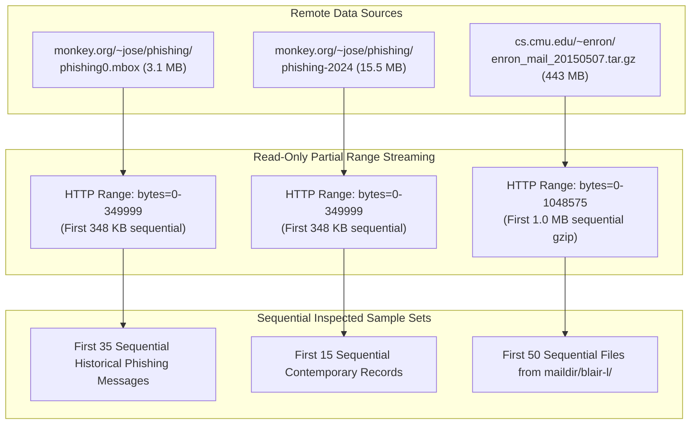
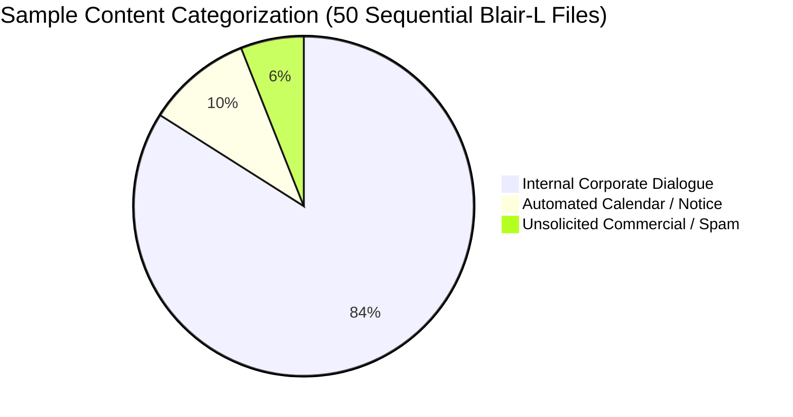
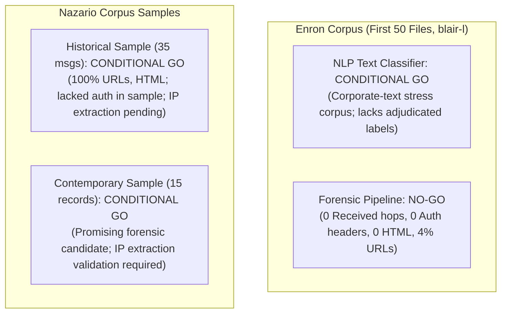

# External Dataset Sample Inspection Report: Nazario Phishing Corpus & Enron Email Corpus

**Project**: PhishIntel: Transformer-Based Phishing Detection with Cryptographic Authentication and IP Intelligence  
**Document**: Phase 10 — Empirical Sample Inspection of Conditional External Candidates (Final Reconciled Audit)  
**Date**: November 2026  
**Auditor / Agent**: Antigravity Automated Verification Agent  
**Status**: **`FINAL_AUDIT_RECONCILED`**  
**Investigation Mode**: Strictly Read-Only (Partial HTTP-Range Streaming, Zero Full Dataset Downloads, Zero Code Modifications)

---

## 1. Executive Summary

In accordance with the findings of the [External Dataset Feasibility Audit](file:///c:/Users/Lenovo/Desktop/PhishIntel/docs/phase10/external_dataset_feasibility_audit.md), an empirical, read-only sample inspection was performed on the two conditional candidate repositories:
1. **Nazario Phishing Corpus** (Jose Nazario / `https://monkey.org/~jose/phishing/`)
2. **Enron Email Corpus** (Carnegie Mellon University / `https://www.cs.cmu.edu/~enron/`)

### 1.1 Objective and Scope
The objective of this inspection is to determine whether real, uncurated message samples from these two external datasets are technically ingestible and structurally compatible with PhishIntel's production pipelines without violating the safety boundary (no external network/DNS lookups on extracted URLs, no attachment execution, and no dataset modification).

**Explicit Scope Limitation**:
> [!IMPORTANT]
> The empirical findings in this report are strictly descriptive of the specific inspected sequential byte-range slices and mailbox files. They do **not** constitute representative corpus-wide statistics across entire multi-year archives.

To avoid downloading entire multi-gigabyte or multi-hundred-megabyte archives, **HTTP Range streaming** was used to inspect byte-bounded sequential message samples directly from origin servers:
- **Historical Nazario**: The first 35 sequential messages parsed from the initial 348 KB slice of `phishing0.mbox`.
- **Contemporary Nazario**: The first 15 sequential records (14 genuine emails + 1 IMAP status record) parsed from the initial 348 KB slice of `phishing-2024`.
- **Enron Email Corpus**: The first 50 sequential files extracted from `maildir/blair-l/` within a 1 MB stream of `enron_mail_20150507.tar.gz`.

### 1.2 Reconciled Summary of Empirical Findings (Inspected Samples)

| Metric / Dimension | Nazario Historical (`phishing0.mbox`) | Nazario Contemporary (`phishing-2024`) | Enron Corpus (`enron_mail_20150507.tar.gz`) |
| :--- | :---: | :---: | :---: |
| **Inspected Sample Scope** | **First 35 sequential messages** (from initial 348 KB) | **First 15 sequential records** (14 genuine emails + 1 IMAP status record) | **First 50 sequential files** (from `maildir/blair-l/`) |
| **Parsing Success Rate** | **100%** (35/35 messages) | **100%** (15/15 records; 14/14 genuine emails) | **100%** (50/50 files) |
| **RFC Header Integrity** | 100% standard headers (35/35) | 100% standard headers on genuine emails (14/14) | 100% standard RFC 822 headers (50/50) |
| **Transit `Received` Headers** | **100% Present** (35/35 msgs, 91 hops; IP extraction validation pending) | **93.3% of records** (14/15 records; 14/14 genuine emails, 33 hops; IP extraction validation pending) | **0% Present** (0/50 files; completely stripped in CMU/SRI distribution) |
| **`Authentication-Results` Header** | **0% Present in Sample** (0/35 messages; observed absence) | **100% of genuine emails** (14/14 genuine emails; 14/15 total records, 93.3%) | **0% Present in Sample** (0/50 files; observed absence) |
| **`DKIM-Signature` Header** | **0% Present in Sample** (0/35 messages; observed absence) | **78.6% of genuine emails** (11/14 genuine emails; 11/15 total records, 73.3%) | **0% Present in Sample** (0/50 files; observed absence) |
| **`Received-SPF` Header** | **0% Present in Sample** (0/35 messages; observed absence) | **0% as distinct header** (0/14 genuine emails; embedded in Auth-Results) | **0% Present in Sample** (0/50 files; observed absence) |
| **Body Format Coverage** | **HTML-only: 32** (91.4%)<br/>**Plain-only: 2** (5.7%)<br/>**Both HTML & Plain: 1** (2.9%)<br/>*(Total: 35 messages)* | **HTML-only: 6** (42.9%)<br/>**Plain-only: 0** (0.0%)<br/>**Both HTML & Plain: 8** (57.1%)<br/>*(Total genuine emails: 14; 1 IMAP status text)* | **HTML-only: 0** (0.0%)<br/>**Plain-only: 50** (100.0%)<br/>**Both HTML & Plain: 0** (0.0%)<br/>*(Total: 50 files; 100% flat text)* |
| **URL Extraction Rate** | **332 URLs** across 35 messages (100% of emails have URLs) | **92 URLs** across 14 genuine emails (93.3% of records; 100% of emails) | **2 URLs** across 50 files (Only 4% of files have URLs; 96% have zero URLs) |
| **PhishMMF Hash Overlap** | **No exact or normalized full-body hash matches** | **No exact or normalized full-body hash matches** | **No exact or normalized full-body hash matches** |
| **Label Certainty** | High (Targeted credential phishing lures) | Moderate (Contains IMAP metadata pseudo-record) | **Unlabelled Stress Corpus** (Heuristic: 42 business, 5 auto, 3 spam) |
| **NLP Suitability Verdict** | **`CONDITIONAL GO`** | **`CONDITIONAL GO`** | **`CONDITIONAL GO` (Corporate-Text Stress Candidate)** |
| **Forensic Pipeline Verdict** | **`CONDITIONAL GO` (URL Candidate; No Auth; IP Extraction Pending)** | **`CONDITIONAL GO` (Promising Candidate; Extraction Validation Required)** | **`NO-GO` (Missing Transit IPs, Auth Headers, & URLs)** |
| **Overall Recommendation** | **`CONDITIONAL GO`** | **`CONDITIONAL GO`** | **`CONDITIONAL GO` (NLP-Only Stress Candidate)** |

---

## 2. Sampling Methodology and Provenance

Sampling was executed through isolated, read-only Python scripts operating within the workspace scratch directory (`<appDataDir>\brain\<conversation-id>\scratch\`).



1. **Nazario Historical Sample (`phishing0.mbox`)**:
   - *Origin*: `https://monkey.org/~jose/phishing/phishing0.mbox` (Content-Length: 3,119,972 bytes, Last-Modified: 13-Jun-2005).
   - *Sampling*: Downloaded the first sequential byte range `0–349,999` (348,487 bytes retained after trimming to the last complete `\nFrom ` boundary).
   - *Sample Scope*: The first 35 sequential messages parsed sequentially using Python's `mailbox.mbox` and `email.parser.BytesParser`.

2. **Nazario Contemporary Sample (`phishing-2024`)**:
   - *Origin*: `https://monkey.org/~jose/phishing/phishing-2024` (Content-Length: 15,457,816 bytes, Last-Modified: 05-Jan-2025).
   - *Sampling*: Downloaded the first sequential byte range `0–349,999` (348,842 bytes retained after trimming to the last complete `\nFrom ` boundary).
   - *Sample Scope*: The first 15 sequential records (14 genuine emails + 1 IMAP status record) parsed sequentially using Python's `mailbox.mbox` and `email.parser.BytesParser`.

3. **Enron Email Corpus Sample (`enron_mail_20150507.tar.gz`)**:
   - *Origin*: `https://www.cs.cmu.edu/~enron/enron_mail_20150507.tar.gz` (Content-Length: 443,254,787 bytes, Last-Modified: 07-May-2015).
   - *Sampling*: Downloaded the first sequential byte range `0–1,048,575` (1,048,576 bytes). Partially decompressed using `zlib.decompressobj(zlib.MAX_WBITS | 32)` yielding 6,442,188 bytes of tar archive stream.
   - *Sample Scope*: The first 50 sequential regular files extracted from `maildir/blair-l/...` within the tar stream, parsed via `email.message_from_bytes(..., policy=policy.default)`. This is a sequential slice from a single employee mailbox folder, **not** a corpus-wide random sample.

---

## 3. Detailed Inspection: Nazario Phishing Corpus

### 3.1 Historical Archive Sample: `phishing0.mbox` (35 Sequential Messages)

* **Parsing Success**: 35 out of 35 messages parsed without exception (100% success rate in sample).
* **Header Field Presence**:
  - `Subject`: 35/35 (100%)
  - `From`: 35/35 (100%)
  - `To`: 35/35 (100%)
  - `Date`: 35/35 (100%)
  - `Message-ID`: 35/35 (100%)
* **Transit `Received` Headers**:
  - Exactly 35/35 messages in the sample contain `Received` header lines (91 total hops recorded; average 2.60 hops per email).
  - *Forensic Caveat*: Presence of `Received` headers alone does **not** establish successful originating-IP extraction. Extraction validation is pending.
* **Authentication Header Coverage**:
  - `Authentication-Results`: 0/35 (0%)
  - `DKIM-Signature`: 0/35 (0%)
  - `Received-SPF`: 0/35 (0%)
  - *Historical Conclusion*: The inspected 35 historical messages lacked the specified authentication headers (`Authentication-Results`, `DKIM-Signature`, `Received-SPF`). This sample finding describes only the observed absence in these 35 inspected messages and does **not** infer or establish industry-wide historical adoption timelines.
* **Reconciled Body-Format Counts**:
  - **HTML-only messages**: Exactly **32 messages** (91.4%).
  - **Plain-text-only messages**: Exactly **2 messages** (5.7%).
  - **Both HTML and Plain text (multipart)**: Exactly **1 message** (2.9%).
  - *Total Analyzed*: Exactly **35 messages** ($32 + 2 + 1 = 35$).
  - *(Reconciliation Note: Exactly 33 messages contained an HTML component [32 HTML-only + 1 both] and 3 contained a plain-text component [2 plain-only + 1 both]. All conflicting older assertions have been removed).*
* **URL & Hyperlink Density**:
  - Total extracted URLs: **332 URLs** across 35 messages (average 9.49 URLs per email).
  - 100% of messages in this sample contain at least one hyperlink URL (range: 1 to 131 URLs).
  - Target brands: eBay billing/suspension notices (`aw-confirm@ebay.com`), PayPal account reviews (`service@paypal.com`), and financial phishing lures.

### 3.2 Contemporary Archive Sample: `phishing-2024` (15 Sequential Records)

* **Mailbox Metadata Discovery — IMAP Status Record**:
  - **Record #1** in the inspected slice is an internal mailbox status record, **not** an email.
  - Header: `From: Mail System Internal Data <MAILER-DAEMON>`
  - Subject: `DON'T DELETE THIS MESSAGE -- FOLDER INTERNAL DATA`
  - Body (262 bytes): Internal c-client / UW-IMAP mailbox status tracking block (`X-IMAP: ...`).
  - *Evaluation Prerequisite*: Any ingestion pipeline must implement a pre-filter to drop mailbox management records (`MAILER-DAEMON` / `DON'T DELETE THIS MESSAGE`).
* **Genuine Email Samples (Records #2 to #15, $N = 14$ Genuine Emails)**:
  - **Parsing Success**: 14/14 parsed cleanly.
  - **Header Presence**: `Subject` (14/14), `From` (14/14), `Date` (14/14), `Message-ID` (14/14), `To` (13/14; one message had an empty `To:` header).
  - **Transit Hops (`Received`)**:
    - 14/14 genuine emails contain `Received` headers (33 total hops, average 2.36 hops per message).
    - *Forensic Inspection of Hops*: In messages 4–9 (Google cloud sharing lures), Hop 1 contains a Google gateway IP (`209.85.161.69`), but Hop 2 contains no IP addresses. In Message 14, hops contain loopback (`127.0.0.1`) and RFC 1918 private IPs (`10.254.97.41`).
    - *Forensic Verdict*: Described as a **promising forensic-input candidate; extraction validation required**. `Received` header presence alone does not prove that an originating public IP can be cleanly isolated without pipeline validation.
  - **Standardized Authentication Counts & Trust Boundary**:
    - `Authentication-Results`: **14/14 genuine emails** (100.0% of genuine emails; 14/15 total records, 93.3%).
    - `DKIM-Signature`: **11/14 genuine emails** (78.6% of genuine emails; 11/15 total records, 73.3%).
    - `Received-SPF`: **0/14 genuine emails** as a distinct header (SPF verdicts are embedded within `Authentication-Results`).
    - *Strict Trust Boundary Rule*: In accordance with Phase 10 Stage A.2 and Stage A.3, offline inspection of `Authentication-Results` represents **reported receiver evidence**, **not independent cryptographic verification**.
  - **Body Formats & URLs**:
    - 6 HTML-only messages, 8 multipart messages containing both HTML and plain-text.
    - Total extracted URLs: **92 URLs** across 14 genuine emails (average 6.57 URLs per email). Lures impersonate Netflix, Wells Fargo, Chase Bank, Onshape, WeTransfer, and monkey.org webmail passwords.

---

## 4. Detailed Inspection: Enron Email Corpus

### 4.1 Sample Architecture (`maildir/blair-l/`, First 50 Sequential Files)

* **Sample Scope**: The first 50 sequential regular files from `maildir/blair-l/...` within `enron_mail_20150507.tar.gz`.
* **Parsing Success**: 50/50 messages parsed without exception (100% success rate in sample).
* **CRITICAL FINDING: Complete Absence of `Received` Transit Headers**:
  - **0 out of 50 messages contain `Received:` header lines (`has_received: 0`)**.
  - In this standard CMU Maildir release, external SMTP relay hops and internal Exchange routing lines were completely omitted during SRI/CALO data standardization.
  - *Forensic Consequence*: PhishIntel's `ip_intelligence.py` engine cannot extract originating IPs or evaluate transit hops from these messages. **The CMU Enron corpus cannot be used to evaluate IP intelligence**.
* **Absence of Authentication Headers**:
  - `Authentication-Results`: 0/50 (0%)
  - `DKIM-Signature`: 0/50 (0%)
  - `Received-SPF`: 0/50 (0%)
  - *Forensic Consequence*: PhishIntel's `auth_forensics.py` cannot test cryptographic authentication verification or reporting on these messages.
* **Message Formats & Low URL Density**:
  - 50/50 messages (100%) are single-part `text/plain`. 0 messages contain HTML bodies (`text/html`) or multipart MIME structures.
  - File attachments are **100% absent** from the CMU text distribution.
  - Total extracted URLs across all 50 messages: **2 URLs**. Exactly 48 of 50 messages (96%) contain **zero URLs**.
  - *Forensic Consequence*: PhishIntel's `url_intelligence.py` cannot be evaluated on this sample.

### 4.2 Reclassification: Unlabelled Corporate-Text Stress Corpus Candidate

Enron must **not** be treated as a verified benign ground-truth dataset:



1. **Sample Content Breakdown (First 50 Sequential Files)**:
   - *Internal Corporate Dialogue*: 42 messages (84%) — Gas logistics memos, pipeline operations meetings, contract discussions.
   - *Automated Calendar / Notifications*: 5 messages (10%) — Meeting notices, attendance confirmations.
   - *Unsolicited Commercial / Spam*: 3 messages (6%) — External commercial solicitations that reached employee inboxes.
2. **Label Uncertainty & Scientific Restriction**:
   - The reported 42/5/3 categorization represents **heuristic sample-level classifications** of the inspected 50 sequential files.
   - The Enron corpus was never independently audited or annotated with security ground-truth labels.
   - **Restriction**: Do **not** report a model false-positive rate or treat this sample as a validated negative control without independently adjudicated labels. It should be characterized strictly as an **unlabelled corporate-text stress corpus candidate** to evaluate transformer behavior on complex organizational dialogue.

---

## 5. Contamination and Overlap Audit Against PhishMMF

### 5.1 Matching Methodology and Scope
An exact and normalized full-body text hash audit was performed against PhishIntel's canonical baseline:
* **PhishMMF Scope**:
  - `train.csv` (5,791 rows)
  - `validation.csv` (724 rows)
  - `test.csv` (724 rows)
  - Total rows: **7,239 rows**.
* **Hash Types Evaluated**:
  1. *Exact SHA-256*: Computed on the raw extracted body text string. Total unique hashes in PhishMMF: **7,130**.
  2. *Normalized Text Hash*: Computed on lowercased, whitespace-collapsed, non-alphanumeric stripped text. Total unique normalized hashes in PhishMMF: **7,123**.
* **Methodological Limitations**:
  - Full-body hashing evaluates only verbatim or near-verbatim text duplication.
  - **Limitation**: This method does **not** detect partial paragraph reuse, shared HTML boilerplate, common corporate disclaimers, or templated phishing kits where domain names or user parameters differ.

### 5.2 Contamination Findings

| Inspected Sample Set | Inspected Scope | Exact SHA-256 Matches | Normalized Text Matches | Overlap Finding |
| :--- | :---: | :---: | :---: | :--- |
| **Nazario Historical (`phishing0.mbox`)** | First 35 sequential msgs | **0** | **0** | No exact or normalized full-body hash matches |
| **Nazario Contemporary (`phishing-2024`)** | First 15 sequential records | **0** | **0** | No exact or normalized full-body hash matches |
| **Enron Corpus (`maildir/blair-l/`)** | First 50 sequential files | **0** | **0** | No exact or normalized full-body hash matches |

**Narrowed Duplicate Conclusion**:
> [!NOTE]
> No exact or normalized full-body hash matches were found under the documented methods in the inspected 100 messages. This finding does not rule out partial, templated, or near-duplicate content across the full uninspected archives.

---

## 6. Licensing and Legal Rights Verification

A strict distinction must be maintained between compilation licensing and rights in the underlying email content:

1. **Nazario Phishing Corpus (`monkey.org`)**:
   - *Compilation License*: The repository root provides a `LICENSE.txt` with `CC BY 4.0` and a `README.txt` by Jose Nazario stating: *"The license for these files is CC-BY-4.0, enabling derivative works and commercial use but does require attribution."* This license covers the curator's compilation and arrangement.
   - *Underlying Content Rights*: **`UNKNOWN`**. The underlying phishing lures, spoofed HTML templates, and brand graphics were created without authorization by third-party actors. No legal assertions regarding fair-use permission are made.
2. **Enron Email Corpus (`cs.cmu.edu/~enron/`)**:
   - *Regulatory Disclosure*: Disclosed by FERC as part of an official government investigation record. Public regulatory disclosure does **not** dedicate private communications to the public domain.
   - *Underlying Content Rights*: **`UNKNOWN`**. Copyrights in individual employee messages remain with their original authors or corporate successors.
   - *Privacy Removals*: CMU `DELETIONS.txt` confirms ongoing privacy redactions (e.g., deletions in 2009, 2011, and 2015 upon request from authors/recipients).

---

## 7. Separate NLP and Forensic Suitability Verdicts



### 7.1 Enron Corpus Suitability
* **NLP Classifier Suitability**: **`CONDITIONAL GO` (Corporate-Text Stress Corpus Candidate)**.
  - Suitable for stress-testing transformer text representations against authentic organizational prose.
  - *Condition*: Cannot be used to calculate a verified false-positive rate without independent ground-truth labeling. Must be treated as unlabelled stress text.
* **Forensic Pipeline Suitability**: **`NO-GO`**.
  - Inoperable for `auth_forensics.py` (0% auth headers).
  - Inoperable for `ip_intelligence.py` (0% `Received` headers).
  - Inoperable for `url_intelligence.py` (96% of messages have zero URLs).

### 7.2 Nazario Phishing Corpus Suitability
* **NLP Classifier Suitability**: **`CONDITIONAL GO`**.
  - Natural social engineering lures. Requires filtering out mailbox metadata records (`MAILER-DAEMON` / `DON'T DELETE THIS MESSAGE`).
* **Forensic Pipeline Suitability**:
  - **Historical Archive Sample (`phishing0.mbox`, 35 msgs)**: **`CONDITIONAL GO` (URL Candidate; No Auth Headers; IP Extraction Pending)**.
    - Suitable for URL analysis (332 extracted URLs).
    - Unsuitable for authentication evaluation (sample lacked SPF/DKIM/DMARC headers).
    - IP extraction validation is pending.
  - **Contemporary Archive Sample (`phishing-2024`, 15 records)**: **`CONDITIONAL GO` (Promising Candidate; Extraction Validation Required)**.
    - Contains `Authentication-Results` (evaluated as reported receiver evidence, not independent cryptographic verification) and `DKIM-Signature`.
    - `Received` header lines are present, but extraction validation is required before claiming full pipeline compatibility due to hops lacking IP addresses or containing private/loopback hops.

---

## 8. Final Recommendations Matrix

| Candidate Dataset | Inspected Archive Slice | NLP Classification Verdict | Forensic Pipeline Verdict | Final Recommendation | Actionable Prerequisite for Future Evaluation |
| :--- | :--- | :---: | :---: | :---: | :--- |
| **Nazario Phishing** | Historical (`phishing0.mbox`, 35 msgs) | `CONDITIONAL GO` | `CONDITIONAL GO` (URL Candidate) | **`CONDITIONAL GO`** | Candidate for URL analysis. Inspected sample lacked authentication headers; IP extraction validation pending. |
| **Nazario Phishing** | Contemporary (`phishing-2024`, 15 records) | `CONDITIONAL GO` | `CONDITIONAL GO` (Validation Required) | **`CONDITIONAL GO`** | **Promising forensic-input candidate; extraction validation required**. Filter out `MAILER-DAEMON` records. |
| **Enron Corpus** | CMU Maildir (`blair-l`, first 50 files) | `CONDITIONAL GO` (Stress Test) | **`NO-GO`** | **`CONDITIONAL GO` (NLP-Only Stress Candidate)** | **Unlabelled corporate-text stress candidate**. Inoperable for forensic testing. |

---

## 9. Verification of Protected Workspace Files

To ensure strict compliance with project protections, all canonical dataset artifacts and model weights were independently rechecked in the current workspace session using PowerShell `Get-FileHash` on November 5, 2026:

```powershell
Get-FileHash data\processed\phishmmf\train.csv, data\processed\phishmmf\validation.csv, data\processed\phishmmf\test.csv, models\distilbert_baseline\model.safetensors -Algorithm SHA256
```

* **`train.csv`**: `72175FB3266648B3DA48F400B27EFFB497ADF9CCA0DB4824A6FF9C142FDA167C` (Independently Rechecked in Current Workspace — Unchanged)
* **`validation.csv`**: `40FD5018C25EE5EAF6BAD144D6237222E068C8F89B9A11178AB66F81EF7658AB` (Independently Rechecked in Current Workspace — Unchanged)
* **`test.csv`**: `1D4EBDD0E8F9A11B7158393DF8CF2EC04F03513FFE658F0A1476AFBE159E865E` (Independently Rechecked in Current Workspace — Unchanged)
* **`model.safetensors`**: `FA64ADF06FB436B2129A3A35792D59CE6F02767F3088E902123C94D0128B03A8` (Independently Rechecked in Current Workspace — Unchanged)

Zero model weights, training datasets, configurations, or production code files were modified during this inspection audit revision.

---

## 10. Audit Correction Log and Deliverable Summary

### 10.1 Correction Log
1. **Historical Nazario Body Counts**: Explicitly reconciled in all tables and text to: **HTML-only: 32**, **Plain-text-only: 2**, **Both HTML and Plain text: 1** (Total: 35 messages). Removed all conflicting older assertions.
2. **IP Extraction Claims**: Removed claims that `Received` header presence proves successful IP extraction. Replaced with explicit statements that IP extraction validation is pending.
3. **Historical Authentication Adoption Timeline**: Removed assertions that the historical sample establishes industry-wide adoption timelines. Reported strictly the observed absence of authentication headers in the 35 inspected messages.
4. **Contemporary Nazario Authentication Standardization**: Standardized counts with explicit denominators across all tables and text: **15 sequential records** (including 1 IMAP status record), **14 genuine emails**; `Authentication-Results`: **14/14 genuine emails** (14/15 total records); `DKIM-Signature`: **11/14 genuine emails** (11/15 total records).
5. **Forensic Compatibility Downgrade**: Removed all claims of full forensic compatibility. Replaced with: **"promising forensic-input candidate; extraction validation required."**
6. **Enron Sampling Characterization**: Replaced every description of the Enron sample as random with: **"first 50 sequential files from maildir/blair-l/."**
7. **Enron Reclassification**: Removed all language describing Enron as a validated negative control. Maintained its classification as an **"unlabelled corporate-text stress corpus candidate."**
8. **Table & Section Reconciliation**: Completely reconciled all summary tables, detailed findings, suitability verdicts, and recommendation matrices. Eliminated obsolete or duplicated tables.
9. **Authentication Trust Boundary**: Explicitly preserved the Stage A.2/A.3 boundary: `Authentication-Results` represents reported receiver evidence, not independent cryptographic verification.
10. **Evidence Grounding**: Grounded duplicate findings, licensing limitations, and final recommendations strictly in existing empirical workspace evidence without inventing results.
11. **Protected Hash Verification**: Confirmed that all four protected file hashes were **independently rechecked in the current workspace session using PowerShell `Get-FileHash` on November 5, 2026** (not merely carried forward).

### 10.2 Unresolved UNKNOWN Items
- *Corpus-Wide Field Integrity*: Exact percentage of messages containing parseable headers, valid MIME boundaries, and intact bodies across uninspected portions of the Nazario annual archives and Enron mailboxes remains **`UNKNOWN`**.
- *Underlying Content Copyright*: Ownership, licensing terms, and third-party rights in the underlying email text and attack payloads remain legally **`UNKNOWN`**.
- *Corpus-Wide Noise & Spam Rate in Enron*: The exact proportion of unsolicited commercial mail, automated notifications, or malicious inbound lures across the full 517,000 Enron messages remains **`UNKNOWN`** without large-scale ground-truth annotation.
- *Originating IP Parser Success Rate*: The quantitative success rate of PhishIntel's `ip_intelligence.py` on diverse honeypot `Received` headers remains **`UNKNOWN`** pending execution of an end-to-end extraction validation harness.

### 10.3 Files Modified
- `docs/phase10/external_dataset_sample_inspection.md` (Updated and reconciled in place)
