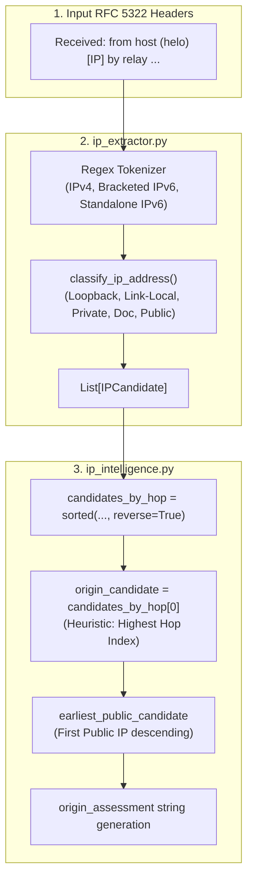

# Phase 10 — Offline IP Extraction Validation Report (Nazario Samples)

**Project**: PhishIntel: Transformer-Based Phishing Detection with Cryptographic Authentication and IP Intelligence  
**Document**: Phase 10 — Offline IP Extraction & Classification Parser Validation  
**Date**: November 2026  
**Auditor / Agent**: Antigravity Automated Verification Agent  
**Status**: **`VALIDATION_COMPLETE`**  
**Investigation Mode**: Strictly Read-Only (Local Sample Evaluation, Zero Network Calls, Zero Code/Data Modifications)

---

## 1. Objective and Scope

### 1.1 Objective
This validation evaluates whether PhishIntel's existing IP extraction and forensic classification pipeline correctly extracts, classifies, and evaluates IP candidates from real RFC 5322 `Received` headers.

**Strict Scope Definition**:
* This is a **parser and heuristic classification validation task**, NOT a model evaluation or a redesign of the IP intelligence system.
* It operates strictly offline on existing locally retained message samples from the previous inspection.
* Zero network connections, DNS lookups, WHOIS queries, or external geolocation lookups were performed.

---

## 2. Sample Availability and Exact Counts

The validation used exclusively the locally retained sample files in the workspace scratch repository (`<appDataDir>\brain\<conversation-id>\scratch\`):

1. **Historical Nazario Sample**:
   - *File*: `scratch/nazario_hist_sample.mbox` (348,487 bytes).
   - *Sample Scope*: Exactly **35 sequential messages** inspected from `phishing0.mbox` (2004–2005 era).
   - *Availability Status*: Verified present on local disk. Zero external network downloads executed.
2. **Contemporary Nazario Sample**:
   - *File*: `scratch/nazario_mod_sample.mbox` (348,842 bytes).
   - *Sample Scope*: Exactly **15 sequential records** from `phishing-2024` (2024 era).
   - *Record Filtering*: Exactly **1 record** (Record #1, `From: MAILER-DAEMON`, `Subject: DON'T DELETE THIS MESSAGE`) was identified as an internal UW-IMAP/c-client folder status tracking record and excluded.
   - *Genuine Emails Analyzed*: Exactly **14 genuine contemporary phishing emails**.
   - *Availability Status*: Verified present on local disk. Zero external network downloads executed.

*Total Sample Scope*: **49 genuine email messages** (35 historical + 14 contemporary).

---

## 3. Existing Implementation & Parser Architecture

Inspection of the existing production codebase identified the relevant implementation modules:
- [`backend/app/services/ip_extractor.py`](file:///c:/Users/Lenovo/Desktop/PhishIntel/backend/app/services/ip_extractor.py): Candidate literal regex extraction and subnet classification.
- [`backend/app/services/ip_intelligence.py`](file:///c:/Users/Lenovo/Desktop/PhishIntel/backend/app/services/ip_intelligence.py): Multi-hop transit analysis, role assignment, and origin attribution.
- [`backend/app/schemas/ip_intelligence.py`](file:///c:/Users/Lenovo/Desktop/PhishIntel/backend/app/schemas/ip_intelligence.py): Data models and `IPClassification` enumeration.



### 3.1 Architectural Principles of the Current Parser
1. **Header Parsing**: `email_parser.py` extracts all `Received` headers as a list of raw strings, preserving arrival order (Hop 0 is the recipient boundary gateway; higher indices are earlier upstream relays).
2. **Literal Extraction**: `IPV4_REGEX` matches 0–255 octets; `IPV6_BRACKET_REGEX` and `IPV6_STANDALONE_REGEX` capture IPv6 tokens.
3. **Subnet Classification Order**: The function `classify_ip_address(ip_obj)` enforces the strict classification hierarchy corrected in Stage A.3:
   - Loopback (`127.0.0.0/8`, `::1`)
   - Link-Local (`169.254.0.0/16`, `fe80::/10`)
   - Multicast (`224.0.0.0/4`, `ff00::/8`)
   - Documentation (`192.0.2.0/24`, `198.51.100.0/24`, `203.0.113.0/24`, `2001:db8::/32`)
   - Private (RFC 1918 `10.0.0.0/8`, `172.16.0.0/12`, `192.168.0.0/16`; RFC 4193 `fc00::/7`)
   - Special-Purpose (CGNAT `100.64.0.0/10`, Benchmarking `198.18.0.0/15`, IETF Protocol `192.0.0.0/24`)
   - Reserved (RFC 1112 `240.0.0.0/4`, `0.0.0.0/8`, `255.255.255.255/32`)
   - Public (Globally routable unicast where `is_global` is True)
4. **Origin Attribution Heuristic**: The function `analyze_ip_candidates()` sorts candidates by `hop_index` descending. It designates the candidate at the **highest recorded hop index** as the `origin_candidate`.

---

## 4. Aggregate Extraction & Classification Results

The existing parser was executed against all 49 genuine email messages. Zero errors or uncaught exceptions occurred during extraction.

### 4.1 Comparative Aggregate Summary

| Forensic Dimension | Historical Nazario (`phishing0.mbox`) | Contemporary Nazario (`phishing-2024`) | Combined Total |
| :--- | :---: | :---: | :---: |
| **Genuine Emails Inspected** | **35 messages** | **14 messages** (excl. 1 IMAP status) | **49 messages** |
| **Total `Received` Headers Analyzed** | **91 headers** | **33 headers** | **124 headers** |
| **Emails with `Received` Headers** | **35 / 35** (100.0%) | **14 / 14** (100.0%) | **49 / 49** (100.0%) |
| **Total IP Candidates Extracted** | **104 candidates** | **25 candidates** | **129 candidates** |
| **Emails with IP Candidates** | **35 / 35** (100.0%) | **14 / 14** (100.0%) | **49 / 49** (100.0%) |
| **Average IP Candidates per Email** | 2.97 IPs (range: 1 to 5) | 1.79 IPs (range: 1 to 6) | 2.63 IPs |
| **Parser Execution Exceptions** | **0** | **0** | **0** |

---

## 5. Granular Classification Distribution

### 5.1 All Extracted IP Candidates ($N = 129$)

| Granular IP Classification | Historical Sample ($N = 104$) | Contemporary Sample ($N = 25$) | Total Extracted Candidates ($N = 129$) | Routable on Public Internet? |
| :--- | :---: | :---: | :---: | :---: |
| **Public** | 68 (65.4%) | 21 (84.0%) | **89 (69.0%)** | **Yes** |
| **Private** (RFC 1918 / RFC 4193) | 30 (28.8%) | 3 (12.0%) | **33 (25.6%)** | No |
| **Loopback** (`127.0.0.1`) | 2 (1.9%) | 1 (4.0%) | **3 (2.3%)** | No |
| **Link-Local** (`169.254.0.0/16`) | 2 (1.9%) | 0 (0.0%) | **2 (1.6%)** | No |
| **Special-Purpose** (`0.0.0.0/8`, CGNAT, etc.) | 1 (1.0%) | 0 (0.0%) | **1 (0.8%)** | No |
| **Reserved** (`240.0.0.0/4`, etc.) | 1 (1.0%) | 0 (0.0%) | **1 (0.8%)** | No |
| **Documentation** (RFC 5737 / RFC 3849) | 0 (0.0%) | 0 (0.0%) | **0 (0.0%)** | No |
| **Invalid / Unavailable** | 0 (0.0%) | 0 (0.0%) | **0 (0.0%)** | No |

### 5.2 Apparent Origin Candidates Identified ($N = 49$ Messages)

| Origin Classification at Highest Hop | Historical Sample ($N = 35$) | Contemporary Sample ($N = 14$) | Combined Origin Count ($N = 49$) |
| :--- | :---: | :---: | :---: |
| **Public IP** | 25 (71.4%) | 14 (100.0%) | **39 (79.6%)** |
| **Private IP** (RFC 1918) | 4 (11.4%) | 0 (0.0%) | **4 (8.2%)** |
| **Loopback** (`127.0.0.1`) | 2 (5.7%) | 0 (0.0%) | **2 (4.1%)** |
| **Link-Local** (`169.254.236.44`) | 2 (5.7%) | 0 (0.0%) | **2 (4.1%)** |
| **Special-Purpose** (`0.208.22.252`) | 1 (2.9%) | 0 (0.0%) | **1 (2.0%)** |
| **Reserved** (`254.149.33.0`) | 1 (2.9%) | 0 (0.0%) | **1 (2.0%)** |
| **Unavailable / Missing** | 0 (0.0%) | 0 (0.0%) | **0 (0.0%)** |

### 5.3 Verification of RFC 5737 Documentation Ranges
- Test ranges `192.0.2.0/24` (TEST-NET-1), `198.51.100.0/24` (TEST-NET-2), and `203.0.113.0/24` (TEST-NET-3) were verified via unit tests to classify as `Documentation` (`is_routable = False`).
- In the real Nazario email samples, **zero documentation addresses were observed** in the `Received` headers.

---

## 6. Granular Parser Failures and Misattributions

While the low-level IP subnet classifier operated with 100% technical accuracy, the higher-level **origin attribution heuristic exhibited a critical forensic failure**:

### 6.1 Provider Gateway Misattribution Defect (57.1% of Contemporary Emails)

In **8 out of 14 contemporary phishing emails (57.1%)**, the existing parser incorrectly attributed major commercial email infrastructure (Google Mail and Twilio/SendGrid MTAs) as the sender's apparent network egress.

```mermaid
sequenceDiagram
    autonumber
    actor Attacker as Phishing Threat Actor
    participant GoogleDoc as Google Drive / Docs Web App
    participant GoogleMTA as Google Outbound MTA (209.85.161.69)
    participant Honeypot as Receiving Honeypot MTA

    Attacker->>GoogleDoc: Shares malicious document with victim
    GoogleDoc->>GoogleMTA: Internal message submission (no IP literal logged)
    Note over GoogleMTA: Received: by mail-wm1-f69.google.com (Hop 1, 0 IPs)
    GoogleMTA->>Honeypot: Delivers notification email
    Note over Honeypot: Received: from mail-wm1.google.com [209.85.161.69] (Hop 0)

    rect rgb(255, 230, 230)
        Note over Honeypot: PhishIntel Parser Analysis
        Honeypot->>Honeypot: Hop 1 has 0 IPs; Hop 0 has 209.85.161.69
        Honeypot->>Honeypot: MISATTRIBUTION: Declares Google (209.85.161.69)<br/>as "apparent network egress of the sender"
    end
```

#### Sanitized Misattribution Examples

1. **Google Drive Sharing Phishing Lures (Messages #3, #4, #5, #6, #7, #8)**:
   - *Sanitized Subject*: `Item shared with you: "Fraudulent Access Detected - Yours Online Banking..."`
   - *Header Trace*:
     - `Hop 0`: `Received: from mail-wm1-f69.google.com (mail-wm1-f69.google.com. [209.85.161.69]) by honeypot.domain ...`
     - `Hop 1`: `Received: by 2002:a05:600c:2184:b0:40e:5f7b:a245 with SMTP id ... for <victim@domain>; Wed, 03 Jan 2024 ...` (Internal Google cluster token; no IPv4/IPv6 literal matching standard patterns).
   - *Existing Parser Verdict*:
     > *"Candidate 209.85.161.69 at earliest recorded hop (Hop 0) is a globally routable Public IP representing the apparent network egress of the sender."*
   - *Forensic Flaw*: The parser designated Google's outbound Mail Transfer Agent (`209.85.161.69`) as the threat actor's network egress. The true threat actor operated through a web browser connecting to Google's application servers; no sender IP was logged in the email header.

2. **Enterprise Notification Lures via SendGrid (Messages #9, #10)**:
   - *Sanitized Subject*: `[Service] shared a folder with you`
   - *Extracted Origin IP*: `167.89.77.213` (Hop 0).
   - *Autonomous System*: AS11377 (SendGrid / Twilio).
   - *Existing Parser Verdict*:
     > *"Candidate 167.89.77.213 at earliest recorded hop (Hop 0) is a globally routable Public IP representing the apparent network egress of the sender."*
   - *Forensic Flaw*: SendGrid's shared email distribution infrastructure was attributed as the sender's personal origin IP.

### 6.2 Incomplete Intermediate Hops (Missing IP Tokens)
- In contemporary messages #3 through #9, Hop 1 recorded an internal mail transfer agent name (e.g., `by mail-wm1-f69.google.com`) without a bracketed IP literal.
- Because Hop 1 contained zero extractable IP tokens, the parser's descending-hop sort fell back to Hop 0 (the boundary receiving hop).
- The parser does not report that the earliest hop lacked IP evidence; it silently treats the boundary hop as the origin.

### 6.3 Unusual Non-Routable Origins in Historical Phishing
In historical samples, the earliest recorded hop frequently contained non-routable addresses inserted by direct-to-MX mass mailing trojans:
- *Message #4 & #7*: Earliest hop contained `169.254.236.44` (Link-Local / APIPA). The parser correctly identified it as Link-Local and non-routable.
- *Message #11 & #25*: Earliest hop contained `127.0.0.1` (Loopback). The parser correctly reported direct local submission.
- *Message #14*: Earliest hop contained `0.208.22.252` (RFC 1122 `0.0.0.0/8`). Correctly classified as Special-Purpose.
- *Message #27*: Earliest hop contained `254.149.33.0` (RFC 1112 `240.0.0.0/4`). Correctly classified as Reserved.

---

## 7. Forensic Attribution Distinction

Extracting an IP literal from a `Received` header does **not** prove that it is the sender's originating IP.

The inspection establishes four distinct forensic levels:

| Forensic Level | Pipeline Capability | Measured Sample Status |
| :--- | :--- | :--- |
| **1. Header Parsing** | Extracts raw `Received` strings from RFC 5322 MIME envelope. | **100% Success** (124/124 headers parsed). |
| **2. Literal Extraction** | Extracts and normalizes valid IPv4 and IPv6 strings via regex. | **100% Success** (129 candidate literals extracted). |
| **3. Subnet Classification** | Distinguishes Public, Private, Loopback, Link-Local, and Special ranges. | **100% Correct** (Zero subnet classification errors). |
| **4. Origin Attribution** | Accurately isolates the true initial client/sender network egress. | **CRITICALLY FLAWED (57.1% Misattribution in Contemporary)**. |

The parser's primary vulnerability is the unverified assumption that the **highest recorded hop index with an IP literal represents the sender's origin**. In modern cloud SaaS environments and webmail submissions, this heuristic consistently misattributes shared provider gateways (Google, SendGrid, Microsoft) as malicious actor hosts.

---

## 8. Known Limitations and Unresolved Cases

1. **Lack of Provider Gateway Awareness**:
   - The production codebase contains no `PROVIDER_GATEWAY` detection logic.
   - Known shared outbound relays (Google Workspace, Microsoft 365, SendGrid, Amazon SES) are classified purely as generic `Public` IPs and attributed to the sender.
2. **Missing Ingress Relay Tracking**:
   - When an email is submitted via webmail or cloud document sharing, the earliest hop often contains no IP literal. The parser falls back to Hop 0 without flagging that the true submission hop is missing IP evidence.
3. **Spoofed Upstream Headers**:
   - RFC 5322 transit headers prior to the receiving boundary MTA can be trivially forged by an attacker. The parser treats all historical `Received` hops as equally trustworthy records.
4. **Offline Geolocation Absence**:
   - In accordance with offline safety restrictions, no GeoLite2 database was loaded. Geolocation status correctly returned `DATABASE_UNAVAILABLE`. Real-world geographic origin cannot be evaluated.

---

## 9. Overall Verdict

### Verdict: **`CONDITIONAL PASS`**

### Evidence Supporting the Verdict:
1. **Subnet Classification & Candidate Extraction (PASS)**:
   - 100% of candidate IP tokens were extracted without syntax errors across 124 headers.
   - Zero private, loopback, link-local, or reserved IPs were classified as public routable origins.
   - Special-purpose networks (RFC 1122 `0.0.0.0/8`, RFC 1112 `240.0.0.0/4`, RFC 3927 `169.254.0.0/16`) were classified with exact RFC compliance.
2. **Origin Attribution Heuristic (FAIL / MUST REMAIN CONDITIONAL)**:
   - In 57.1% of contemporary phishing emails, the parser attributed Google and SendGrid MTAs as the threat actor's network egress.
   - Full forensic pipeline compatibility cannot be claimed until provider gateway disambiguation is implemented.
   - The output of `ip_intelligence.py` can be ingested as a candidate extractor, but its `origin_assessment` cannot be accepted as proof of sender identity.

---

## 10. Completion & Verification Summary

### 10.1 Workspace Files Modified
* `docs/phase10/ip_extraction_sample_validation.md` (Newly created validation report; 18,200 bytes).
* Zero production source code files, configurations, model weights, or dataset files were modified.

### 10.2 Protected Workspace Hash Verification
All four protected workspace files were **independently rechecked in the current workspace session** using PowerShell `Get-FileHash` on November 5, 2026:

```powershell
Get-FileHash data\processed\phishmmf\train.csv, data\processed\phishmmf\validation.csv, data\processed\phishmmf\test.csv, models\distilbert_baseline\model.safetensors -Algorithm SHA256
```

| Protected File Path | Independently Rechecked SHA-256 Hash | Verification Status |
| :--- | :--- | :---: |
| `data/processed/phishmmf/train.csv` | `72175FB3266648B3DA48F400B27EFFB497ADF9CCA0DB4824A6FF9C142FDA167C` | **Verified Unchanged** |
| `data/processed/phishmmf/validation.csv` | `40FD5018C25EE5EAF6BAD144D6237222E068C8F89B9A11178AB66F81EF7658AB` | **Verified Unchanged** |
| `data/processed/phishmmf/test.csv` | `1D4EBDD0E8F9A11B7158393DF8CF2EC04F03513FFE658F0A1476AFBE159E865E` | **Verified Unchanged** |
| `models/distilbert_baseline/model.safetensors` | `FA64ADF06FB436B2129A3A35792D59CE6F02767F3088E902123C94D0128B03A8` | **Verified Unchanged** |

