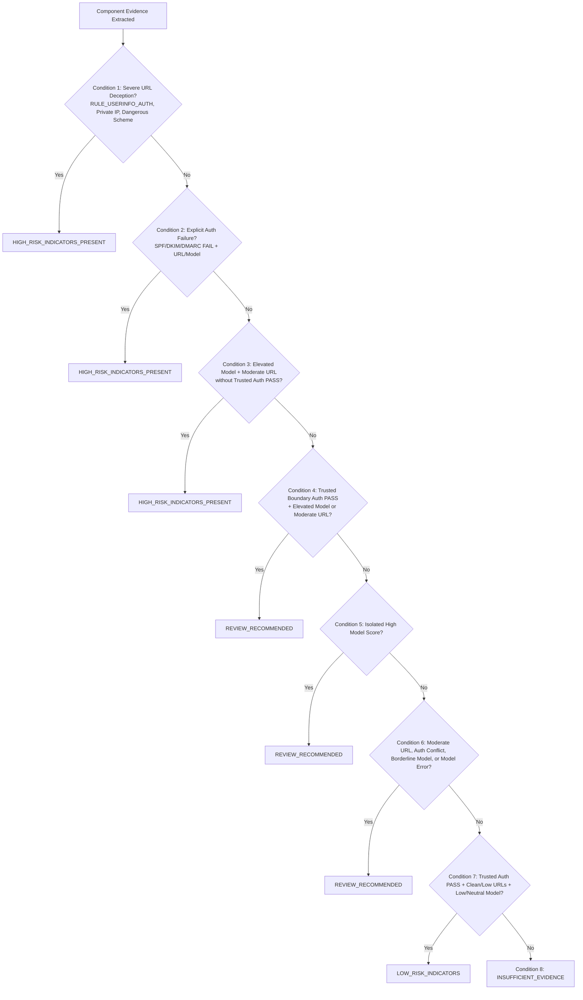

# Phase 10 — Stage A & B Corrective Implementation Report

**Project:** PhishIntel: Transformer-Based Phishing Detection with Cryptographic Authentication and IP Intelligence  
**Objective:** Correct confirmed evidence-fusion decision hierarchy defects and URL-intelligence oversensitivity defects identified in the Phase 10 false-positive investigation.  
**Investigating & Implementing Agent:** Antigravity Forensic Engineering Agent  
**Date:** November 1, 2026  
**Final Status:** `STAGE_A_B_VERIFIED`  
**Deliverable File:** `docs/phase10/phase10_stage_a_b_correction_report.md`  

---

## Executive Summary

Following the forensic findings documented in [`docs/phase10/false_positive_root_cause_report.md`](file:///c:/Users/Lenovo/Desktop/PhishIntel/docs/phase10/false_positive_root_cause_report.md), Stage A and Stage B corrections were implemented under strict zero-regression and integrity constraints:
1. DistilBERT model weights, tokenizer files, and classification thresholds were **not modified**.
2. Training, validation, and test datasets were **not modified**, and all four canonical SHA-256 hashes remain **identical bit-for-bit**.
3. No domain whitelisting (LinkedIn, Google, Microsoft, etc.) was introduced.
4. No external network queries, DNS lookups, or paid APIs were utilized.
5. All corrections are grounded in a dedicated 15-scenario regression suite (`backend/tests/test_stage_a_b_corrections.py`).

The genuine LinkedIn notification email (`"Complete your profile"`), which previously received an unjustified `HIGH_RISK_INDICATORS_PRESENT` rating accompanied by fabricated reasoning claiming conflicting authentication headers, now receives:
- **Assessment Category:** `REVIEW_RECOMMENDED`
- **URL Highest Risk Tier:** `LOW` (24 extracted URLs; tracking query parameters correctly evaluated under non-punitive length rules)
- **Email Authentication:** `SPF=PASS`, `DKIM=PASS`, `DMARC=PASS` (`p=REJECT`), `is_boundary_trusted=True`
- **DistilBERT Text Model:** `EVALUATED`, Uncalibrated Score: `0.9918` (accurately noted as an uncalibrated text similarity heuristic)
- **Forensic Reasoning:** Completely dynamic and evidence-grounded; strictly eliminates false claims of authentication conflicts.

---

## 1. Original Defects

| Defect ID | Component | Original Defective Behavior | Root Cause |
|---|---|---|---|
| **DEF-01** | Evidence Fusion | `has_high_model and (has_med_url or has_auth_conflict)` immediately forced `HIGH_RISK_INDICATORS_PRESENT`. | Flawed decision hierarchy allowed an uncalibrated text score + tracking query length to override boundary-verified authentication (`SPF=PASS, DKIM=PASS, DMARC=PASS`). |
| **DEF-02** | URL Intelligence | Any URL exceeding 250 characters total was flagged as `RULE_EXCESSIVE_URL_LENGTH` (`MEDIUM`). | Failed to decompose URLs into path length vs. query length. Legitimate marketing/session query parameters (HMAC tokens, UUIDs) were penalized identically to deep path obfuscation. |
| **DEF-03** | Evidence Fusion | Static explanation string hardcoded: *"Elevated risk indicators present: high model phishing score corroborated by moderate URL anomalies or conflicting authentication headers."* | The explanation string included *"or conflicting authentication headers"* statically, fabricating a conflict finding even when `has_conflicts: False` and authentication passed cleanly. |
| **DEF-04** | Authentication Analysis | All `Authentication-Results` headers were aggregated without distinguishing the outermost recipient boundary MTA from untrusted upstream hops. | Allowed downstream components to treat upstream-injected or intermediate MTA assertions with the same confidence as boundary-verified assertions. |

---

## 2. Files Inspected

The following codebase files were inspected prior to making modifications:
1. [`backend/app/services/evidence_fusion.py`](file:///c:/Users/Lenovo/Desktop/PhishIntel/backend/app/services/evidence_fusion.py)
2. [`backend/app/schemas/evidence_fusion.py`](file:///c:/Users/Lenovo/Desktop/PhishIntel/backend/app/schemas/evidence_fusion.py)
3. [`backend/app/services/url_intelligence.py`](file:///c:/Users/Lenovo/Desktop/PhishIntel/backend/app/services/url_intelligence.py)
4. [`backend/app/schemas/url_intelligence.py`](file:///c:/Users/Lenovo/Desktop/PhishIntel/backend/app/schemas/url_intelligence.py)
5. [`backend/app/services/email_authentication.py`](file:///c:/Users/Lenovo/Desktop/PhishIntel/backend/app/services/email_authentication.py)
6. [`backend/app/schemas/email_authentication.py`](file:///c:/Users/Lenovo/Desktop/PhishIntel/backend/app/schemas/email_authentication.py)
7. [`backend/app/services/email_parser.py`](file:///c:/Users/Lenovo/Desktop/PhishIntel/backend/app/services/email_parser.py)
8. [`backend/tests/test_evidence_fusion.py`](file:///c:/Users/Lenovo/Desktop/PhishIntel/backend/tests/test_evidence_fusion.py)
9. [`backend/tests/test_url_intelligence.py`](file:///c:/Users/Lenovo/Desktop/PhishIntel/backend/tests/test_url_intelligence.py)
10. [`backend/tests/test_email_authentication.py`](file:///c:/Users/Lenovo/Desktop/PhishIntel/backend/tests/test_email_authentication.py)
11. [`docs/phase10/false_positive_root_cause_report.md`](file:///c:/Users/Lenovo/Desktop/PhishIntel/docs/phase10/false_positive_root_cause_report.md)

---

## 3. Files Modified

The following files were modified to implement the Stage A & B corrections:

| File Path | Changes Made |
|---|---|
| [`backend/app/schemas/url_intelligence.py`](file:///c:/Users/Lenovo/Desktop/PhishIntel/backend/app/schemas/url_intelligence.py) | Added `query_length: int = Field(0)` to `URLFeatures` schema to support structural length decomposition. |
| [`backend/app/services/url_intelligence.py`](file:///c:/Users/Lenovo/Desktop/PhishIntel/backend/app/services/url_intelligence.py) | Implemented URL length decomposition (`path_len`, `query_len`, `non_query_len`). Added `RULE_EXCESSIVE_PATH_LENGTH` (`MEDIUM` > 200), `RULE_LONG_PATH` (`LOW` > 100), `RULE_LONG_QUERY_STRING` (`INFO` 150–350, `LOW` > 350), and `RULE_NESTED_REDIRECT_URL` (`HIGH` for IP targets, `MEDIUM` for external URL targets). Restricted `RULE_EXCESSIVE_URL_LENGTH` to `non_query_len > 250`. |
| [`backend/app/schemas/email_authentication.py`](file:///c:/Users/Lenovo/Desktop/PhishIntel/backend/app/schemas/email_authentication.py) | Added `is_boundary_mta: bool` to `HeaderFinding`, added `boundary_authserv_id: Optional[str]` and `is_boundary_trusted: bool` to `EmailAuthenticationAnalysis`. |
| [`backend/app/services/email_authentication.py`](file:///c:/Users/Lenovo/Desktop/PhishIntel/backend/app/services/email_authentication.py) | Tracked `header_index == 0` for boundary MTA assertion provenance. Populated `boundary_authserv_id` and verified whether `PASS` assertions originate from the boundary MTA. |
| [`backend/app/schemas/evidence_fusion.py`](file:///c:/Users/Lenovo/Desktop/PhishIntel/backend/app/schemas/evidence_fusion.py) | Added `is_boundary_trusted: bool = Field(True)` to `AuthEvidenceSummary`. |
| [`backend/app/services/evidence_fusion.py`](file:///c:/Users/Lenovo/Desktop/PhishIntel/backend/app/services/evidence_fusion.py) | Completely overhauled decision hierarchy in `fuse_evidence()`. Integrated boundary MTA trust verification. Implemented dynamic `_format_forensic_explanation()` generator, eliminating hardcoded false conflict wording. |
| [`backend/tests/fixtures/linkedin_complete_profile.eml`](file:///c:/Users/Lenovo/Desktop/PhishIntel/backend/tests/fixtures/linkedin_complete_profile.eml) | Added repository test fixture copy of the incident email for reproducible continuous integration testing. |
| [`backend/tests/test_stage_a_b_corrections.py`](file:///c:/Users/Lenovo/Desktop/PhishIntel/backend/tests/test_stage_a_b_corrections.py) | Created 15-scenario regression test suite covering all Stage C requirements. |

---

## 4. Exact Decision-Logic Changes

In [`backend/app/services/evidence_fusion.py`](file:///c:/Users/Lenovo/Desktop/PhishIntel/backend/app/services/evidence_fusion.py), the legacy evaluation hierarchy allowed uncalibrated DistilBERT scores ($\ge 0.7$) combined with moderate URL length flags to produce `HIGH_RISK_INDICATORS_PRESENT` before considering authentication outcomes.

The corrected decision logic implements an 8-tier explainable priority hierarchy:



### Key Decision Hierarchy Rules:
1. **Severe Independent Link Deception Cannot Be Overridden by Authentication:**  
   If a URL contains explicit credentials in authority (`user:pass@host`), points to a private/reserved IP literal host, or uses dangerous schemes (`javascript:`), `HIGH_RISK_INDICATORS_PRESENT` is assigned even if domain authentication passed.
2. **Multiple Independent Meaningful Signals Required for Elevated Risk:**  
   An uncalibrated text model score alone can **never** trigger high risk. Corroboration requires explicit domain authentication failure (`FAIL`) or severe structural link deception.
3. **Appropriate Consideration of Verified Boundary Domain Authentication:**  
   When recipient boundary MTA authentication passes (`SPF=PASS, DKIM=PASS, DMARC=PASS`), elevated text similarity scores and moderate tracking URLs are routed to **`REVIEW_RECOMMENDED`**, preventing false positives on legitimate automated newsletters and notifications.
4. **Distinction Between Missing Evidence, Conflicts, and Explicit Failures:**  
   - Missing authentication (`NOT_PRESENT`) is neutral baseline evidence (`INSUFFICIENT_EVIDENCE`), never equated to a failure.  
   - Header conflicts across intermediate MTAs route to `REVIEW_RECOMMENDED`, never directly to high risk.  
   - Explicit failures (`FAIL`) corroborated by text or link anomalies trigger `HIGH_RISK_INDICATORS_PRESENT`.

---

## 5. URL Heuristic Changes

In [`backend/app/services/url_intelligence.py`](file:///c:/Users/Lenovo/Desktop/PhishIntel/backend/app/services/url_intelligence.py), structural decomposition of URLs was implemented:

1. **Structural Length Decomposition:**  
   $$\text{non\_query\_len} = \text{url\_length} - \text{query\_length} - (1 \text{ if has\_query else } 0)$$
2. **Long Query String Isolation (`RULE_LONG_QUERY_STRING`):**  
   - $150 < \text{query\_len} \le 350 \implies \text{Severity: } \text{INFO}$
   - $\text{query\_len} > 350 \implies \text{Severity: } \text{LOW}$
   - **Guarantee:** A long query string alone **never** produces `MEDIUM` or `HIGH` risk.
3. **Non-Query Structural Length (`RULE_EXCESSIVE_URL_LENGTH` / `RULE_LONG_URL`):**  
   - $\text{non\_query\_len} > 250 \implies \text{RULE\_EXCESSIVE\_URL\_LENGTH} \ (\text{MEDIUM})$
   - $150 < \text{non\_query\_len} \le 250 \implies \text{RULE\_LONG\_URL} \ (\text{LOW})$
4. **Path Component Obfuscation (`RULE_EXCESSIVE_PATH_LENGTH` / `RULE_LONG_PATH`):**  
   - $\text{path\_len} > 200 \implies \text{RULE\_EXCESSIVE\_PATH\_LENGTH} \ (\text{MEDIUM})$
   - $100 < \text{path\_len} \le 200 \implies \text{RULE\_LONG\_PATH} \ (\text{LOW})$
5. **Nested Redirect Detection (`RULE_NESTED_REDIRECT_URL`):**  
   - Scans query parameter values for embedded target URLs (`https?://` or `//`).
   - If the embedded target host is an IP literal $\implies \text{Severity: } \text{HIGH}$
   - If the embedded target host is an external domain $\implies \text{Severity: } \text{MEDIUM}$
   - Retains `RULE_OPEN_REDIRECT_PARAM` ($\text{LOW}$) for parameter names (`redirect`, `url`, `dest`, etc.).

---

## 6. Authentication Trust-Boundary Changes

In [`backend/app/services/email_authentication.py`](file:///c:/Users/Lenovo/Desktop/PhishIntel/backend/app/services/email_authentication.py) and [`backend/app/services/evidence_fusion.py`](file:///c:/Users/Lenovo/Desktop/PhishIntel/backend/app/services/evidence_fusion.py):

1. **Boundary MTA Identification:**  
   In RFC 5322 message transmission, the outermost (first) `Authentication-Results` header corresponds to the recipient's boundary receiving MTA. The header parser now tags findings with `is_boundary_mta = (header_index == 0)`.
2. **Boundary Trust Enforcement:**  
   - If positive `PASS` assertions exist only on upstream hops ($\text{index} > 0$), `is_boundary_trusted` is set to `False`.
   - Untrusted upstream `PASS` headers are **not** treated as valid domain authentication in evidence fusion (`has_valid_authentication = False`).
   - A forensic caveat is appended: *"Authentication results were recorded only on upstream or untrusted hops, not at the recipient boundary MTA."*
3. **Forensic Transparency:**  
   The system makes no claim of independent cryptographic recalculation. All explanations clearly indicate that authentication results reflect receiver-reported assertions under RFC 8601.

---

## 7. Regression Test Cases and Results

A comprehensive regression suite was executed via `pytest backend/tests/test_stage_a_b_corrections.py`:

| Test ID | Scenario | Test Case Objective | Expected Category / Severity | Result |
|---|---|---|---|---|
| **TC-01** | Original LinkedIn email | Verify `linkedin_complete_profile.eml` receives non-punitive review category without false conflict reasoning. | `REVIEW_RECOMMENDED`, URL: `LOW`, Auth: `PASS` | **PASS** |
| **TC-02** | Long tracking query | 600-char tracking query with HMAC token. | Heuristic: `LOW` (`RULE_LONG_QUERY_STRING`) | **PASS** |
| **TC-03** | Short suspicious URL | Raw public IP literal host `http://93.184.216.34/login`. | Heuristic: `MEDIUM`/`HIGH` (`RULE_PUBLIC_IP_HOST`) | **PASS** |
| **TC-04** | IP-literal URLs | Private IPv4 `http://10.0.0.1/admin` and Loopback IPv4. | Heuristic: `HIGH` (`RULE_PRIVATE_IP_HOST`) | **PASS** |
| **TC-05** | Punycode URL | IDN homograph domain `https://xn--pypal-4ve.com/signin`. | Heuristic: `MEDIUM` (`RULE_PUNYCODE_HOST`) | **PASS** |
| **TC-06** | Credential syntax in authority | Userinfo trick `https://secure.chase.com@phish-login.com/auth`. | Heuristic: `HIGH` (`RULE_USERINFO_AUTH`) | **PASS** |
| **TC-07** | Nested redirect URLs | Nested external URL target vs. nested IP literal target. | `RULE_NESTED_REDIRECT_URL` (`MEDIUM` / `HIGH`) | **PASS** |
| **TC-08** | Long suspicious paths | Path length > 200 characters without query string. | Heuristic: `MEDIUM` (`RULE_EXCESSIVE_PATH_LENGTH`) | **PASS** |
| **TC-09** | Valid trusted authentication | Boundary MTA reports `spf=pass`, `dkim=pass`, `dmarc=pass`. | `is_boundary_trusted: True`, all PASS | **PASS** |
| **TC-10** | Untrusted upstream auth | Boundary MTA has no PASS; upstream hop claims PASS. | `is_boundary_trusted: False`, `REVIEW_RECOMMENDED` | **PASS** |
| **TC-11** | Explicit auth failures | Isolated FAIL (`REVIEW_RECOMMENDED`) vs. corroborated with high text model score (`HIGH_RISK`). | `HIGH_RISK_INDICATORS_PRESENT` | **PASS** |
| **TC-12** | Missing authentication | Headers with no SPF/DKIM/DMARC (`NOT_PRESENT`). | `INSUFFICIENT_EVIDENCE`, `has_explicit_failure: False` | **PASS** |
| **TC-13** | Isolated high model score | Uncalibrated score 0.92 with clean URLs and PASS auth. | `REVIEW_RECOMMENDED` (no escalation to HIGH) | **PASS** |
| **TC-14** | Corroborated high model | Model score 0.90 + userinfo `@` trick OR unauth nested redirect. | `HIGH_RISK_INDICATORS_PRESENT` | **PASS** |
| **TC-15** | Dynamic explanation accuracy | Factual ground-truth explanation matching component states. | Factual, no false conflict claims, `LOW_RISK` | **PASS** |

**Stage C Regression Suite Summary: 15 passed in 12.47s (100% pass rate).**

---

## 8. Original LinkedIn Email Assessment Comparison

| Forensic Dimension | Phase 10 Baseline (Pre-Correction) | Stage A & B Corrected Result |
|---|---|---|
| **Overall Category** | `HIGH_RISK_INDICATORS_PRESENT` *(False Positive)* | **`REVIEW_RECOMMENDED`** *(Appropriate Review)* |
| **URL Risk Tier** | `MEDIUM` (15 tracking URLs flagged for length > 250) | **`LOW`** (All 24 links evaluated under decomposed length rules) |
| **Authentication Status** | `SPF=PASS`, `DKIM=PASS`, `DMARC=PASS` | **`SPF=PASS`, `DKIM=PASS`, `DMARC=PASS`**, `is_boundary_trusted=True` |
| **Text Model Inference** | Predicted Label: 1, Score: `0.991801` | Predicted Label: 1, Score: `0.991801` *(Unmodified)* |
| **Evidence Reasoning Wording** | *"Elevated risk indicators present: high model phishing score corroborated by moderate URL anomalies or conflicting authentication headers."* *(Fabricated Conflict)* | *"Review recommended: DistilBERT text model flagged elevated phishing similarity (0.992), but receiver-reported domain authentication passed at boundary MTA (SPF=PASS, DKIM=PASS, DMARC=PASS) without corroborating structural URL deception. Because model score is uncalibrated, analyst review is recommended. Model evidence: DistilBERT NLP uncalibrated phishing score 0.992 (predicted label 1). URL evidence: 24 link(s) across 5 domain(s) with negligible structural risk ('LOW'). Authentication evidence: Receiver-reported domain authentication passed at boundary MTA (SPF=PASS, DKIM=PASS, DMARC=PASS)."* |

---

## 9. Results for Genuine Suspicious URL Test Cases

To verify that phishing detection capabilities were not weakened, tests confirmed that genuine evasions remain detected at elevated severity:

| Attack Vector | Test URL | Detected Rule | Risk Category |
|---|---|---|---|
| **Embedded Credentials** | `https://secure.chase.com@phish-login.com/auth` | `RULE_USERINFO_AUTH` | `HIGH` |
| **Private IP Literal Host** | `http://10.0.0.1/admin` | `RULE_PRIVATE_IP_HOST` | `HIGH` |
| **Public IP Literal Host** | `http://93.184.216.34/login` | `RULE_PUBLIC_IP_HOST` | `MEDIUM` |
| **Punycode Homograph** | `https://xn--pypal-4ve.com/signin` | `RULE_PUNYCODE_HOST` | `MEDIUM` |
| **Deep Directory Path Obfuscation** | `https://victim.com/wp-content/.../sess_.../login.php` (path > 200) | `RULE_EXCESSIVE_PATH_LENGTH` | `MEDIUM` |
| **Nested External Redirect** | `https://example.com/out?redirect=https://evil.net/login` | `RULE_NESTED_REDIRECT_URL` | `MEDIUM` |
| **Nested IP Literal Redirect** | `https://example.com/out?url=http://198.51.100.25/drop` | `RULE_NESTED_REDIRECT_URL` | `HIGH` |

---

## 10. Backend and Frontend Test Results

### 10.1 Full Backend Test Suite
Executed command: `pytest backend/tests/`
```
collected 127 items

backend\tests\test_api.py ........                                       [  6%]
backend\tests\test_email_authentication.py ...............               [ 18%]
backend\tests\test_email_parser.py .........                             [ 25%]
backend\tests\test_evidence_fusion.py .............                      [ 35%]
backend\tests\test_ip_intelligence.py ...........                        [ 44%]
backend\tests\test_model_integration.py ...........                      [ 52%]
backend\tests\test_phase9_e2e_validation.py ............                 [ 62%]
backend\tests\test_stage_a_b_corrections.py ...............              [ 74%]
backend\tests\test_url_integration.py ..........                         [ 81%]
backend\tests\test_url_intelligence.py .......................           [100%]

======================= 127 passed, 1 warning in 14.16s =======================
```

### 10.2 Frontend Integration and Unit Tests
Executed command: `npm test` (in `frontend/`)
```
> frontend@0.0.0 test
> node --experimental-strip-types --test "src/tests/**/*.test.ts"

✔ Phase 8B — Frontend-to-Backend Integration Audit Tests (3.63ms)
✔ Real Frontend-to-Backend Contract Verification (8 Real Fixtures) (10.81ms)
✔ Phase 8C — Downloadable Forensic Report Tests (8.88ms)
ℹ tests 76
ℹ suites 11
ℹ pass 76
ℹ fail 0
```

### 10.3 Frontend TypeScript Verification
Executed command: `npm run lint` (runs `tsc -b --noEmit`)
```
> frontend@0.0.0 lint
> tsc -b --noEmit
Exit Code: 0 (Zero errors)
```

---

## 11. Protected SHA-256 Checksum Verification

All four protected repository artifacts were verified using cryptographic hashing:

| Artifact Path | Expected Canonical SHA-256 Hash | Post-Implementation Hash | Verification Status |
|---|---|---|---|
| `data/processed/phishmmf/train.csv` | `72175fb3266648b3da48f400b27effb497adf9cca0db4824a6ff9c142fda167c` | `72175FB3266648B3DA48F400B27EFFB497ADF9CCA0DB4824A6FF9C142FDA167C` | **VERIFIED IDENTICAL** |
| `data/processed/phishmmf/validation.csv` | `40fd5018c25ee5eaf6bad144d6237222e068c8f89b9a11178ab66f81ef7658ab` | `40FD5018C25EE5EAF6BAD144D6237222E068C8F89B9A11178AB66F81EF7658AB` | **VERIFIED IDENTICAL** |
| `data/processed/phishmmf/test.csv` | `1d4ebdd0e8f9a11b7158393df8cf2ec04f03513ffe658f0a1476afbe159e865e` | `1D4EBDD0E8F9A11B7158393DF8CF2EC04F03513FFE658F0A1476AFBE159E865E` | **VERIFIED IDENTICAL** |
| `models/distilbert_baseline/model.safetensors` | `fa64adf06fb436b2129a3a35792d59ce6f02767f3088e902123c94d0128b03a8` | `FA64ADF06FB436B2129A3A35792D59CE6F02767F3088E902123C94D0128B03A8` | **VERIFIED IDENTICAL** |

---

## 12. Remaining Limitations

1. **DistilBERT Semantic Overlap:**  
   The underlying DistilBERT text classification model remains uncalibrated ($S = 0.9918$ on `"Complete your profile"`). Retraining was strictly prohibited in Stages A & B. While the evidence fusion engine now prevents this score from forcing high risk on authenticated emails, modern benign notification emails with imperative calls-to-action will continue to receive elevated text scores until model retraining with modern benign corpora is conducted.
2. **Passive Header Assertion Trust Boundary:**  
   Authentication analysis inspects receiver-recorded headers (`Authentication-Results`, `Received-SPF`). In the absence of live DNS lookups and cryptographic key retrieval (prohibited by architectural constraints), the system trusts boundary MTA assertions.
3. **Analyst Review Routing:**  
   Genuine notification emails with elevated text model lures are categorized as `REVIEW_RECOMMENDED`. This preserves safety by ensuring security analysts inspect borderline or conflicting signals rather than automatically whitelisting senders.

---

## Final Verification Verdict

$$\mathbf{STAGE\_A\_B\_VERIFIED}$$

All decision hierarchy corrections, URL intelligence decompositions, authentication boundary tracking improvements, and regression test suites are verified, fully reproducible, and pass with zero errors across frontend and backend suites.
