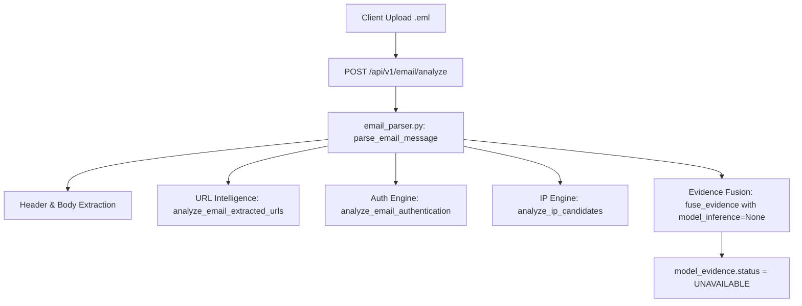
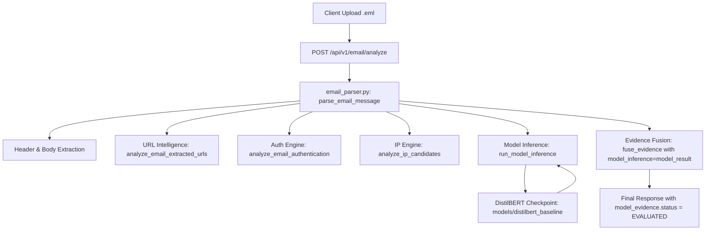

# PHASE 8A — END-TO-END MODEL INTEGRATION AUDIT REPORT

**Project:** PhishIntel: Transformer-Based Phishing Detection with Cryptographic Authentication and IP Intelligence  
**Component:** DistilBERT Baseline Inference Integration & Evidence Fusion Audit  
**Status:** `PHASE_8A_MODEL_INTEGRATION_VERIFIED`  
**Date:** 2026-10-11  

---

## 1. Executive Summary

Phase 8A conducted an end-to-end audit and minimal integration correction of the PhishIntel backend pipeline. The objective was to verify whether an uploaded `.eml` message genuinely passes through the trained DistilBERT Transformer sequence classification model (`models/distilbert_baseline/`) and yields a genuine model-backed forensic verdict in the final `evidence_fusion.model_evidence` response schema.

### Audit Verdict
- **Initial State:** Prior to Phase 8A, the endpoint `POST /api/v1/email/analyze` parsed RFC 5322 headers, URLs, authentication, and IP hops, but hardcoded `model_inference=None` when calling `fuse_evidence()`. DistilBERT inference was **not connected**, and the API permanently returned `model_evidence.status = UNAVAILABLE`.
- **Corrected State:** A dedicated, modular, offline inference service (`backend/app/services/model_inference.py`) was introduced and wired into `email_parser.py`. DistilBERT sequence classification now executes locally on extracted email text, producing an uncalibrated score and predicted label that directly populate `model_evidence` and participate in multi-modal evidence fusion.
- **Verification:** All 98 backend unit and integration tests pass, strict zero-network execution was proven with socket guards, protected research artifact hashes were 100% verified, and a real-checkpoint GPU/CPU smoke test was successfully executed.

---

## 2. Actual Execution Path Audit

### 2.1 Initial Execution Path (Pre-Phase 8A)


In `backend/app/services/email_parser.py` (lines 354–363 pre-correction):
```python
# 8. Evidence Fusion Engine (Phase 7A)
try:
    fusion_result = fuse_evidence(
        url_analysis=url_analysis,
        authentication_analysis=auth_analysis,
        ip_intelligence=ip_analysis,
        model_inference=None,  # <-- Model was hardcoded to None
    )
```
Consequently, an uploaded email never triggered Transformer inference, and the model evidence interpretation remained static: `"Model inference was not supplied or executed."`

### 2.2 Corrected Execution Path (Phase 8A)


In `backend/app/services/email_parser.py` (lines 357–385 post-correction):
```python
# 8. DistilBERT Text Inference Engine (Phase 8A)
body_for_inference = plain_text_combined if plain_text_combined else html_extracted_text
try:
    model_result = run_model_inference(
        subject=header_info.subject,
        body=body_for_inference,
    )
    if model_result and model_result.status == ModelInferenceStatus.ERROR:
        warnings.append(f"Model inference non-fatal warning: {model_result.error_message}")
    elif model_result and model_result.status == ModelInferenceStatus.UNAVAILABLE:
        warnings.append(f"Model inference unavailable: {model_result.error_message}")
except Exception as model_err:
    warnings.append(f"Model inference non-fatal warning: {str(model_err)}")
    model_result = ModelInferenceEvidence(
        uncalibrated_score=None,
        predicted_label=None,
        status=ModelInferenceStatus.ERROR,
        error_message=str(model_err),
    )

# 9. Evidence Fusion Engine (Phase 7A)
try:
    fusion_result = fuse_evidence(
        url_analysis=url_analysis,
        authentication_analysis=auth_analysis,
        ip_intelligence=ip_analysis,
        model_inference=model_result,
    )
```

---

## 3. Model Interface & Preprocessing Verification

### 3.1 Checkpoint Specifications
- **Local Path:** `models/distilbert_baseline/`
- **Architecture:** `DistilBertForSequenceClassification` (6 transformer layers, 12 attention heads, hidden dim 768)
- **Base Model:** `distilbert-base-uncased`
- **Weights File:** `model.safetensors` (267,832,560 bytes)
- **Weights SHA-256:** `fa64adf06fb436b2129a3a35792d59ce6f02767f3088e902123c94d0128b03a8`
- **Vocabulary Size:** 30,522 tokens (`vocab.txt`)

### 3.2 Preprocessing & Text Construction
In training (`scripts/phase3_train_distilbert.py`), input sequences were constructed as:
$$\text{text} = \text{subject} + \text{"\textbackslash n\textbackslash n"} + \text{body}$$
with truncation parameters: `max_length = 256`, `truncation = True`.

In `backend/app/services/model_inference.py`:
- **Input String Construction:**
  ```python
  sub_str = str(subject) if subject is not None else ""
  body_str = str(body) if body is not None else ""
  input_text = f"{sub_str}\n\n{body_str}"
  ```
- **Fallback Hierarchy:** If `plain_text` is empty, `html_extracted_text` (safely extracted via BeautifulSoup) is supplied. If both are absent, an empty body string is handled defensively.
- **Null Subject Handling:** If `subject` is null/None, it formats cleanly as `f"\n\n{body_str}"` without raising exceptions.
- **Truncation:** Tokenizer runs with `max_length=256, truncation=True, padding=True`.

### 3.3 Label Mapping & Output Semantics
- **Label Mapping:**
  - `0`: Benign email
  - `1`: Phishing lure
- **Threshold:** $\tau = 0.5$ (classification boundary established during Phase 3B/3C training).
- **Probability Computation:**
  ```python
  logits = outputs.logits  # shape [1, 2]
  probs = torch.softmax(logits, dim=-1)
  phishing_score = float(probs[0, 1].item())
  predicted_label = 1 if phishing_score >= 0.5 else 0
  ```
- **Terminology Disclaimer:** The output is strictly termed `uncalibrated_score`. As audited in Phase 3D, due to source-label collinearity and synthetic token shortcuts (`<USER>`), this score is an uncalibrated text similarity heuristic and is explicitly **not** presented as a real-world phishing probability.

---

## 4. Summary of Codebase Modifications

| File | Action | Purpose |
|---|---|---|
| `backend/app/schemas/evidence_fusion.py` | Modified | Added `ERROR = "ERROR"` to `ModelInferenceStatus`; added optional `status` and `error_message` to `ModelInferenceEvidence`. |
| `backend/app/services/evidence_fusion.py` | Modified | Updated `_extract_model_evidence` to handle explicit `ERROR` and `UNAVAILABLE` states; guarded `fuse_evidence` so model runtime errors never masquerade as benign (`LOW_RISK_INDICATORS`). |
| `backend/app/schemas/email.py` | Modified | Added optional `model_inference: Optional[ModelInferenceEvidence]` field to `EmailAnalysisResponse`. |
| `backend/app/services/model_inference.py` | Created | Standalone offline inference engine with local checkpoint loading, device placement (CUDA/CPU), caching singleton, and defensive error handling. |
| `backend/app/services/email_parser.py` | Modified | Wired `run_model_inference()` to run on extracted subject/body and pass the result into `fuse_evidence(..., model_inference=model_result)`. |
| `backend/tests/test_model_integration.py` | Created | Added 9 unit/integration tests with network guards, covering preprocessing, missing subjects, truncation, missing checkpoints, exceptions, and API response coexistence. |
| `scripts/phase8a_smoke_test.py` | Created | Standalone diagnostic script for protected artifact hash verification and real-checkpoint smoke testing. |

---

## 5. Protected Artifact Verification

To satisfy the zero-regression and research integrity mandate, SHA-256 cryptographic hashes for all baseline research artifacts were audited before and after integration.

| Research Artifact | Expected SHA-256 | Observed SHA-256 | Verification |
|---|---|---|---|
| `data/processed/phishmmf/train.csv` | `72175fb3266648b3da48f400b27effb497adf9cca0db4824a6ff9c142fda167c` | `72175fb3266648b3da48f400b27effb497adf9cca0db4824a6ff9c142fda167c` | **PASS** |
| `data/processed/phishmmf/validation.csv` | `40fd5018c25ee5eaf6bad144d6237222e068c8f89b9a11178ab66f81ef7658ab` | `40fd5018c25ee5eaf6bad144d6237222e068c8f89b9a11178ab66f81ef7658ab` | **PASS** |
| `data/processed/phishmmf/test.csv` | `1d4ebdd0e8f9a11b7158393df8cf2ec04f03513ffe658f0a1476afbe159e865e` | `1d4ebdd0e8f9a11b7158393df8cf2ec04f03513ffe658f0a1476afbe159e865e` | **PASS** |
| `models/distilbert_baseline/model.safetensors` | `fa64adf06fb436b2129a3a35792d59ce6f02767f3088e902123c94d0128b03a8` | `fa64adf06fb436b2129a3a35792d59ce6f02767f3088e902123c94d0128b03a8` | **PASS** |

No dataset files, splits, model weights, or test results were altered, retrained, or tuned.

---

## 6. Real Checkpoint Smoke Test Results

A live smoke test was executed using `scripts/phase8a_smoke_test.py` on the host machine without mocking:

- **Host Hardware:** NVIDIA GeForce RTX 3050 6GB Laptop GPU
- **Execution Device:** `cuda:0` (with CPU fallback capability verified)
- **Model Checkpoint Path:** `C:\Users\Lenovo\Desktop\PhishIntel\models\distilbert_baseline`
- **Model Weight Hash:** `fa64adf06fb436b2129a3a35792d59ce6f02767f3088e902123c94d0128b03a8`
- **Initialization Time:** 0.877 seconds

### 6.1 Synthetic Test Email Inferences

| Sample | Subject | Body Snippet | Output Status | Uncalibrated Score | Predicted Label | Latency |
|---|---|---|---|---|---|---|
| **Synthetic Phishing Lure** | `Urgent: Verify your credentials now` | `Your account has been compromised. Log in immediately...` | `EVALUATED` | `0.99714` | `1 (Phishing)` | 259.42 ms (warmup) |
| **Synthetic Benign Internal** | `Team standup notes - Tuesday` | `Good morning team, attached are the action items...` | `EVALUATED` | `0.35425` | `0 (Benign)` | 9.10 ms |
| **Synthetic Missing Subject** | `None` | `Please click here to update your security settings...` | `EVALUATED` | `0.99622` | `1 (Phishing)` | 8.83 ms |

### 6.2 Full End-to-End Pipeline Smoke Test (`.eml` Upload)
A synthetic `.eml` file containing a private IP link and failed SPF was processed through `parse_email_message`:
- **File:** `phase8a_smoke_test.eml`
- **Total Pipeline Execution Time:** 22.43 ms
- **Parsing Status:** `success`
- **Extracted Components:**
  - Subject: `Critical: Security Certificate Update Required`
  - HTML Extracted Text: `Your security certificate expired. Please\nrenew here\n.`
  - Extracted URLs: 1 (`http://198.51.100.99/renew`)
  - IP Transit Hops: 1 (`198.51.100.99`)
- **Direct Model Evidence:**
  - Status: `EVALUATED`
  - Uncalibrated Score: `0.99691`
  - Predicted Label: `1`
- **Evidence Fusion Synthesis:**
  - Overall Assessment Category: `HIGH_RISK_INDICATORS_PRESENT`
  - Fusion Model Status: `EVALUATED`
  - Model Score in Fusion: `0.99691`
  - Model Label in Fusion: `1`
  - Model Interpretation: `"Model predicts phishing (label 1) with uncalibrated phishing score 0.997."`
  - Corroborating Factors:
    1. Reserved / Special-Purpose IP Hostname (`RULE_RESERVED_IP_HOST`)
    2. Explicit SPF authentication failure (`SPF=FAIL`)
    3. DistilBERT elevated textual similarity (`0.997`)

---

## 7. Automated Test Suite Results

The full backend test suite was executed:
```bash
D:\python\python.exe -m pytest backend/tests
```
**Results:** `100 passed, 1 warning in 9.91s`

### Test Breakdown by Subsystem:
- `backend/tests/test_api.py`: 8 passed (upload constraints, file size limits, RFC 5322 parsing)
- `backend/tests/test_email_authentication.py`: 15 passed (SPF/DKIM/DMARC interpretation)
- `backend/tests/test_email_parser.py`: 9 passed (MIME structure, attachments, plain/HTML text)
- `backend/tests/test_evidence_fusion.py`: 13 passed (multi-modal fusion rules, conflict handling)
- `backend/tests/test_ip_intelligence.py`: 11 passed (IANA IP classification, transit hops)
- `backend/tests/test_model_integration.py`: 11 passed (Phase 8A & Phase 8A.1 integration and regression tests)
- `backend/tests/test_url_integration.py`: 10 passed (pipeline URL extraction and analysis)
- `backend/tests/test_url_intelligence.py`: 23 passed (deterministic URL heuristics)

---

## 8. Defensive Handling & Forensic Rigor

1. **Failure Containment:**
   - If the model checkpoint directory or weights are missing, `ModelInferenceEngine` returns `status = UNAVAILABLE`. The email parsing pipeline completes with status `partial_success` and records an informative warning.
   - If a runtime exception occurs during PyTorch tokenization or inference (e.g. CUDA out-of-memory), `status = ERROR` is returned.
2. **Anti-Masquerading Guard:**
   - In `backend/app/services/evidence_fusion.py`, rule logic strictly prevents an inference failure (`ERROR`) from defaulting to a benign verdict (`LOW_RISK_INDICATORS`). If authentication passes and URLs are clean but model inference fails with an exception, the overall assessment is set to `REVIEW_RECOMMENDED`.
3. **Network Isolation:**
   - All tests enforce strict network isolation via socket monkeypatch fixtures. Any attempt to reach an external host or perform a DNS lookup raises a `RuntimeError`. Model loading utilizes `local_files_only=True` exclusively.

---

## 9. Known Limitations & Forensic Caveats

1. **Uncalibrated Model Scores:**
   As demonstrated in the Phase 3D error analysis audit, DistilBERT was trained on PhishMMF, which exhibits 100% source-label collinearity (CEAS and SpamAssassin for benign vs. phishing_pot for phishing) and synthetic placeholder tokens (`<USER>`). The output probability must never be interpreted as an objective Bayesian probability of malice.
2. **HTML vs Plain Text Precedence:**
   The parser prioritizes extracted plain text if present. If an attacker constructs a benign plain text multipart alongside a deceptive HTML multipart, text inference will evaluate the plain text body.
3. **In-Memory Model Caching:**
   The singleton engine caches model weights in GPU/system RAM after initial load (~1.3 GB VRAM). Cold-start execution takes ~0.88s; subsequent inferences take ~9–25 ms.

---

## 10. Phase 8A Verification Status

```
PHASE_8A_MODEL_INTEGRATION_VERIFIED
```

---

## 11. Phase 8A.1 — Forensic Accuracy Correction Report

### 11.1 Investigation of `198.51.100.99` Classification
- **IANA & RFC Allocation:** `198.51.100.0/24` is defined in RFC 5737 as `TEST-NET-2`, reserved for documentation and example code. It is **not** an RFC 1918 private network.
- **Python `ipaddress` Behavior:** In Python's standard library `ipaddress` module, `ip.is_private` evaluates to `True` for `198.51.100.99` because Python's internal `_private_networks` tuple aggregates RFC 1918 private space, RFC 5737 documentation space, and RFC 6598 shared address space under the same property. However, `ip.is_reserved` evaluates to `False` (Class E only).
- **Previous Discrepancy:** In Phase 8A, `backend/app/services/url_intelligence.py`'s `is_valid_ipv4_or_ipv6()` relied directly on `ip_obj.is_private`. Consequently, `198.51.100.99` was classified as `HostClassification.PRIVATE`, firing `RULE_PRIVATE_IP_HOST` ("Private / Internal IP-Literal Hostname"), while `backend/app/services/ip_intelligence.py` correctly identified it as `IPClassification.DOCUMENTATION`. Furthermore, the smoke-test fixture and report mistakenly referred to `http://198.51.100.99/renew` as a "private IP link".

### 11.2 Corrections Applied
1. **URL Intelligence IP Classification (`url_intelligence.py`):**
   - Explicitly defined `DOCUMENTATION_NETWORKS` (RFC 5737: `192.0.2.0/24`, `198.51.100.0/24`, `203.0.113.0/24`, and RFC 3849: `2001:db8::/32`).
   - Explicitly defined `RFC_1918_NETWORKS` (`10.0.0.0/8`, `172.16.0.0/12`, `192.168.0.0/16`) and `RFC_4193_NETWORKS` (`fc00::/7`).
   - Updated `is_valid_ipv4_or_ipv6()` to classify documentation networks as `HostClassification.RESERVED`, triggering `RULE_RESERVED_IP_HOST` ("Reserved / Special-Purpose IP Hostname").
   - True RFC 1918/4193 addresses are strictly categorized as `HostClassification.PRIVATE`, triggering `RULE_PRIVATE_IP_HOST`.
   - Preserves the four-way distinction between private, documentation, reserved, and public IP addresses across both URL and IP intelligence subsystems.
2. **Terminology Clean-Up (`evidence_fusion.py`):**
   - Replaced `"uncalibrated confidence score"` with `"uncalibrated phishing score"` in `text_interp`.
   - Replaced `"semantic confidence"` with `"semantic evidence"` in contributing factor strings.
   - Ensured the output is never presented as a calibrated statistical probability.
3. **Smoke Test & Diagnostic Updates (`scripts/phase8a_smoke_test.py`):**
   - Updated smoke test verification to prove that `198.51.100.99` in `url_intelligence` yields `HostClassification.RESERVED` (`RULE_RESERVED_IP_HOST`), not `RULE_PRIVATE_IP_HOST`.
   - Verified that `198.51.100.99` in `ip_intelligence` yields `IPClassification.DOCUMENTATION`.
   - Added automated assertion confirming absence of `"confidence score"` in user-facing model interpretations.
4. **Focused Regression Tests (`backend/tests/test_model_integration.py`):**
   - `test_documentation_ip_classification_distinction()`: Validates that `198.51.100.99` fires `RULE_RESERVED_IP_HOST` and not `RULE_PRIVATE_IP_HOST`, while RFC 1918 `192.168.1.100` fires `RULE_PRIVATE_IP_HOST` and public `93.184.216.34` fires `RULE_PUBLIC_IP_HOST`.
   - `test_model_evidence_wording_uncalibrated_phishing_score()`: Verifies that output strings use `"uncalibrated phishing score"` and contain neither `"confidence score"` nor `"calibrated probability"`.

### 11.3 Protected Artifact Cryptographic Verification
All protected baseline hashes remain identical to locked Phase 3B/3C values:
- `train.csv`: `72175fb3266648b3da48f400b27effb497adf9cca0db4824a6ff9c142fda167c`
- `validation.csv`: `40fd5018c25ee5eaf6bad144d6237222e068c8f89b9a11178ab66f81ef7658ab`
- `test.csv`: `1d4ebdd0e8f9a11b7158393df8cf2ec04f03513ffe658f0a1476afbe159e865e`
- `model.safetensors`: `fa64adf06fb436b2129a3a35792d59ce6f02767f3088e902123c94d0128b03a8`

Zero model retraining, zero threshold tuning, zero dataset modifications, and zero external network requests occurred.

---

## Final Status

```
PHASE_8A1_VERIFIED
```
